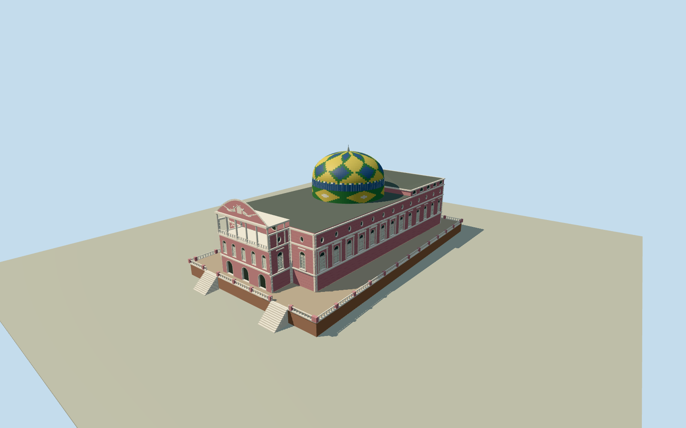

# Amazon Theatre

Complete native pink RenaissanceRevivaltheatre with its small east/front projection, white quoins/cornices, physically recessed tall round-headed shuttered lights, oval attic oculi and rear semicircle attic windows. Separate rear stage roof, real open five-bay upper entrance loggia with columns/balustrade, segmental pediment and bounded original allegorical low relief. Distinctive green/yellow/blue ceramic-patterned drum/shallow dome and crown/finial. Intrinsic bounded raised retaining terrace, pale/pink balustrades and paired access stairs. Heights/dome position/concealed sections/terrace are photographic estimates; complete native main building outline retained.

Authoring state: **review-in-qa.json**. Current completion evidence is in [qa.json](qa.json) and the [completion ledger](../../../../qualla-structures/batches/qualla-002.PROGRESS.md).

- [Amazon Theatre](https://qualla.com/amazon-theatre/)

Original named theatrebuildingway794449274/TeatroAmazonas/Q1434444retains the complete signed8-corner native outline including its small east/front projection. Native plan supplies no heights, dome circle/center, internal roof divisions or exterior terrace outline. Those elevations/dome/terrace details are photo-based medium-fi estimates. Native+X points north across the east-facing front; +Zpoints east/front; main body length runs east-west.

The complete signed native8-corner building plan and small east projection remain fixed. Main facade17.6m, rear attic19.4m, front pediment23.6m, dome30.2m/finial32.1m,10.6mradius/dome position and hidden roof divisions are explicit photographic medium-fi estimates, not surveys. Main front faces east.

Two exact Qualla-published RidiculopathyCC0exteriors were fully inspected:4608x2592side/rear view and4608x2128east/plaza view. Trees conceal lower front details; five-bay loggia, lower doorway/window rhythms, roof junctions, sculptural relief/fine carving and hidden faces are conservative original interpretations. The similarly named cafe interior/plaza sculpture photos and other sources are unused.

Pink plaster, pale dressings, muted slate, red-brown stone and ceramic national-color lozenge pattern follow the current photographs. Dome tiles, white ribs, shutters, stone courses, ornament and simplified reclining allegorical figures are original mesh/color details, not photographic pixels or exact reproductions of every tile/portrait/letter. No interior/cafe/auditorium seating, chandelier, detached plaza monument, neighboring cathedral/courthouse, road/paving, vegetation, utilities, people or vehicles.

The documented intrinsic retaining terrace is estimated44mwide,76mlong and3.6mhigh at the fixed front approach datum. Its boundaries, precise stairs, balustrade repeat and foundation/host-terrain contact remain approximate. Narrow footings extend.35m below datum. This is not a terrain flattening or city-wide platform; original source relief remains unchanged.

All four LODs retain the complete theatre/dome/entrance/raised terrace silhouette. Curved window recesses, shutter louvres, quoins, balusters, pediment relief, roof/crown trim and ceramic tile subdivisions simplify with distance. Open loggia remains bounded; model is an exterior asset without navigable interior.

Build: `node packages/worldgen/scripts/generate-authored-places.mjs --ids=amazon_theatre`. Add `--check` to verify exact regeneration. 60627 triangles; 6 materials; no embedded photographs.
