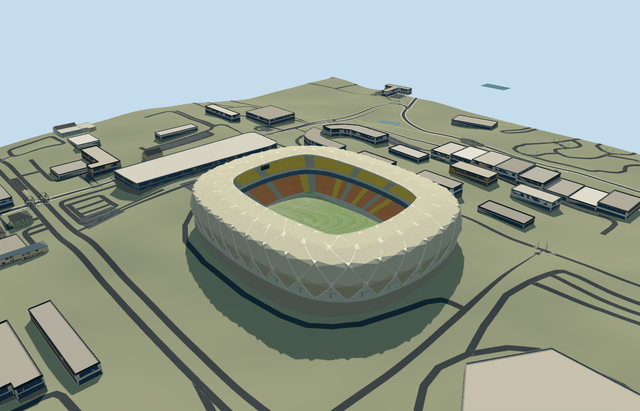

# arena_amazonia — Arena Amazônia

Reviewed2026-10-20 in one author/build/inspect/fix pass.

## Appearance

Inspected48 final current views: source turntable/details, shared-surface placement, noon/late economy/high, four LODs, original native terrain/context and failed load. Own rounded basket shell/large diagonal lozenge membrane panels/real triangular base openings/recessed concrete-glazed galleries, diagonal hollow-box canopy frame/closed skins/open central aperture/inner rim, two orange-red/yellow seating tiers/closed hospitality fascia/pale aisles/neutral football field/goals/supported end displays. Replaced intersecting overlay skins with one partitioned membrane/frame skin and moved the upper service gallery behind the seating during this author/build/inspect pass. Corner rounding/frame repetition are deliberately finite polygonal approximations; roof shoulder retains visible facets.

## Shared surfaces and browser budgets

Five existing shared256px graphs: concrete_plain, metal_painted, membrane, fabric_canvas and window_grid. No embedded images, private texture atlas or copied photographic pixels. Runtime reads each required graph once; five near draws/one skyline draw. Separate position/normal GPU streams and equal CPU/GPU byte accounting. Neutral daylight/shared reflected sky/shadows checked; glazing and roof optics remain approximate.

| Level | Triangles | Bytes | Draws |
| --- | ---: | ---: | ---: |
| skyline | 536 | 51164 | 1 |
| district | 2918 | 293460 | 5 |
| street | 12334 | 1032832 | 5 |
| closeup | 48686 | 4158404 | 5 |

Four authored levels preserve the mapped body/open field, lozenge shell silhouette, two tiers and base portals. Far levels merge rows/diagonal members and simplify hidden backs/services. Skyline/district/street/closeup536/2918/12334/48686triangles; initial skyline plus district344624bytes, below3MB phone/6MB laptop asset targets. These are asset budgets/automated renders; physical laptop/phone/tablet and dense-city timings remain pending.

## Approximate native placement

RetainedQ641527/named stadiumPOI35185204834783 identify main parent52776563754247; separate pitch35185451107955 supplies113.000291x76.625125m field-surround axis. Own47-point outer/38-point roof hole establish approximately244x201m body/162x120m roof aperture; roof aperture is not the playing field. Anchor[-60.02814288847929,-3.0832095088176454]/heading0/native east-south/internal X[0.0038910224279519756,0.9999924299435797]/Z[-0.9999924299435797,0.0038910224279519756]. Retain independent Arena Poliesportiva Amadeu Teixeira and neighboring buildings. No exact-QID native field; ordinary photographs/named point/retained identity/native geometry establish the stated approximate fit. Fine20degree/2m facing remains approximate. Production helper removes only own stadium52776563754247; all92 resident independent inputs of93 originals/all148 wider independent inputs remain unchanged. Native6m grid/roads/1925.1598693113774m2 water retained. Five actual PMTiles13/14/15 cases pass. Failure retains93 originals; every level unload restores ground/water/zero live geometry. Original standard6m Mapzen samples/native roads/water/independent context remain unchanged. Original anchor datum40.077157500617304m defines modelY0. Owned common retaining floor is supported below the minimum original boundary grade; columns extend to individual original samples. A bounded ground opening stays within the main body/all-level occupied floor. Only own stadium parent is replaced using99.5percent whole-feature coverage; generalized merged records use bounded clipping. No surrounding sports-complex platform/DEM edits/water removal. Failure/unload retains or restores original context. The15.65m native boundary range includes coarse roof/ground sampling uncertainty; common platform height is explicitly approximate.

## Limits

Three ordinary architect-gallery photographs were viewed: city aerial, close exterior and bowl. No bespoke survey/terrain/archive research or copied crowd/event/seat graphics. POI elevation32 denotes geographic altitude and is not used as architectural height. No qualified native building height. Working common field/podium11.1m above original anchor datum clears the highest boundary sample10.6975m; visible retaining height is a coarse-DEM visualization compromise rather than a surveyed terrace. Basket shoulder31m/canopy34..34.5m above field, two tiers1.4..12m/17..26m, belt12..17m, galleries7/14/23m and rounded lozenge/box dimensions are picture-led estimates. Finite diagonal modules simplify the actual curved frame inventory; no engineering, surveyed floor elevation, exact membrane optics or current-condition claim. Undated project photographs are completed-reference views, not proof of subsequent condition. Original standard6m Mapzen samples/native roads/water/independent context remain unchanged. Original anchor datum40.077157500617304m defines modelY0. Owned common retaining floor is supported below the minimum original boundary grade; columns extend to individual original samples. A bounded ground opening stays within the main body/all-level occupied floor. Only own stadium parent is replaced using99.5percent whole-feature coverage; generalized merged records use bounded clipping. No surrounding sports-complex platform/DEM edits/water removal. Failure/unload retains or restores original context. The15.65m native boundary range includes coarse roof/ground sampling uncertainty; common platform height is explicitly approximate.

## Selected checks

Six Khronos files: zero errors/warnings.3546 actual geometry/material/contact checks,48 current inspected views,five actual native map-level cases. Selected source/import/placement/strict medium-fi/scene validation pass. Sim30 hash2f0d360c03f1c9a2dfdc6aab6b3e4c1fa793aa9fe1b498bac794bdc3ed1c7b13.

Source sha256:9cfe2825273ae10d5a4a442a8864cfcb3de8bb763170924bd4157daf57b72446

Runtime sha256:815672351de5dddc35ac69ea8777412aee4f04590c077590c3c569f747c608d6

Input sha256:d2c247910181a011ebbd52ec458b05db25bcd70fb0080765e2e2c844318053a1

Rebuild: node packages/worldgen/scripts/generate-additional-landmarks.mjs --ids=arena_amazonia; node packages/worldgen/scripts/import-structure-models.mjs --ids=arena_amazonia; node packages/tooling/scripts/generate-landmark-lods.mjs --ids=arena_amazonia --force.

## Ordinary picture references

https://www.gmp.de/en/projects/535/arena-da-amazonia — https://www.gmp.de/images/gmp_2283_MB86_MAN_6922.jpg?w=1400; gmp project gallery lists gmp and Marcus Bredt; individual frame credit not separately verified; Copyright retained; viewed only/no pixels copied. Viewed only/no copied pixels.

https://www.gmp.de/en/projects/535/arena-da-amazonia — https://www.gmp.de/images/gmp_2283_MB86_MAN_6304.jpg?w=1400; gmp project gallery lists gmp and Marcus Bredt; individual frame credit not separately verified; Copyright retained; viewed only/no pixels copied. Viewed only/no copied pixels.

https://www.gmp.de/en/projects/535/arena-da-amazonia — https://www.gmp.de/images/gmp_2283_MB86_MAN_5522.jpg?w=1400; gmp project gallery lists gmp and Marcus Bredt; individual frame credit not separately verified; Copyright retained; viewed only/no pixels copied. Viewed only/no copied pixels.
