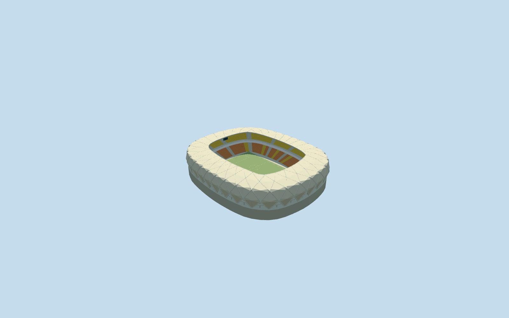

# Arena Amazônia

Specific completed-reference Arena Amazônia: own native rounded body/central roof aperture, continuous pale lozenge membrane/diagonal hollow-box basket across facade and canopy/closed backs/deep crossing members/smooth inner compression rim, real bottom triangular openings/recessed concrete-glazed galleries/local original-grade supports/owned retaining podium, two orange-red and yellow seating tiers/pale aisles/closed hospitality strip/neutral football field/goals/supported displays. Five existing shared material graphs, no unique atlas/copied event imagery/seat lettering/hidden furnished rooms/whole sports precinct slab.

## Evidence and reconstruction

Published dimensions and reconstructed details are separated in spec.json. Primary references:

- [Reference](https://www.gmp.de/en/projects/535/arena-da-amazonia)

Specific completed-reference Arena Amazônia: own native rounded body/central roof aperture, continuous pale lozenge membrane/diagonal hollow-box basket across facade and canopy/closed backs/deep crossing members/smooth inner compression rim, real bottom triangular openings/recessed concrete-glazed galleries/local original-grade supports/owned retaining podium, two orange-red and yellow seating tiers/pale aisles/closed hospitality strip/neutral football field/goals/supported displays. Five existing shared material graphs, no unique atlas/copied event imagery/seat lettering/hidden furnished rooms/whole sports precinct slab.

## Model and axes

48,686 triangles; 146,058 vertices; 5 material groups; 5,845,724 bytes. Native bounds: -101.650, -5.557, -122.058 to 99.412, 45.700, 122.082. Source hash: `sha256:9cfe2825273ae10d5a4a442a8864cfcb3de8bb763170924bd4157daf57b72446`.

{"x":"east","y":"up","z":"south"}

The geographic proposal uses exact-QID OpenStreetMap evidence. Map-derived orientation and estimated architectural details require real-site visual review; preview eligibility is distinct from geographic/fidelity approval. Map attribution: © OpenStreetMap contributors, ODbL-1.0.

## Reproduce

Run `node packages/worldgen/scripts/generate-additional-landmarks.mjs --ids=arena_amazonia` (or add `--check`). The generator preserves manually edited masters by checking their baseline hashes. Import through the standard authored-model workflow with optimization disabled; then capture all QA cameras, including shared-surface views.

## Pending work

- Specific completed-reference Arena Amazônia: own native rounded body/central roof aperture, continuous pale lozenge membrane/diagonal hollow-box basket across facade and canopy/closed backs/deep crossing members/smooth inner compression rim, real bottom triangular openings/recessed concrete-glazed galleries/local original-grade supports/owned retaining podium, two orange-red and yellow seating tiers/pale aisles/closed hospitality strip/neutral football field/goals/supported displays. Five existing shared material graphs, no unique atlas/copied event imagery/seat lettering/hidden furnished rooms/whole sports precinct slab.
- RetainedQ641527/named stadiumPOI35185204834783 identify main parent52776563754247; separate pitch35185451107955 supplies113.000291x76.625125m field-surround axis. Own47-point outer/38-point roof hole establish approximately244x201m body/162x120m roof aperture; roof aperture is not the playing field. Anchor[-60.02814288847929,-3.0832095088176454]/heading0/native east-south/internal X[0.0038910224279519756,0.9999924299435797]/Z[-0.9999924299435797,0.0038910224279519756]. Retain independent Arena Poliesportiva Amadeu Teixeira and neighboring buildings. No exact-QID native field; ordinary photographs/named point/retained identity/native geometry establish the stated approximate fit. Fine20degree/2m facing remains approximate.
- POI elevation32 denotes geographic altitude and is not used as architectural height. No qualified native building height. Working common field/podium11.1m above original anchor datum clears the highest boundary sample10.6975m; visible retaining height is a coarse-DEM visualization compromise rather than a surveyed terrace. Basket shoulder31m/canopy34..34.5m above field, two tiers1.4..12m/17..26m, belt12..17m, galleries7/14/23m and rounded lozenge/box dimensions are picture-led estimates. Finite diagonal modules simplify the actual curved frame inventory; no engineering, surveyed floor elevation, exact membrane optics or current-condition claim. Undated project photographs are completed-reference views, not proof of subsequent condition.
- Original standard6m Mapzen samples/native roads/water/independent context remain unchanged. Original anchor datum40.077157500617304m defines modelY0. Owned common retaining floor is supported below the minimum original boundary grade; columns extend to individual original samples. A bounded ground opening stays within the main body/all-level occupied floor. Only own stadium parent is replaced using99.5percent whole-feature coverage; generalized merged records use bounded clipping. No surrounding sports-complex platform/DEM edits/water removal. Failure/unload retains or restores original context. The15.65m native boundary range includes coarse roof/ground sampling uncertainty; common platform height is explicitly approximate.

This bundle follows the medium-fi standard. Medium-fi appearance and geographic fit are reviewed separately. Hash-bound visual acceptance is recorded separately after capture inspection.
