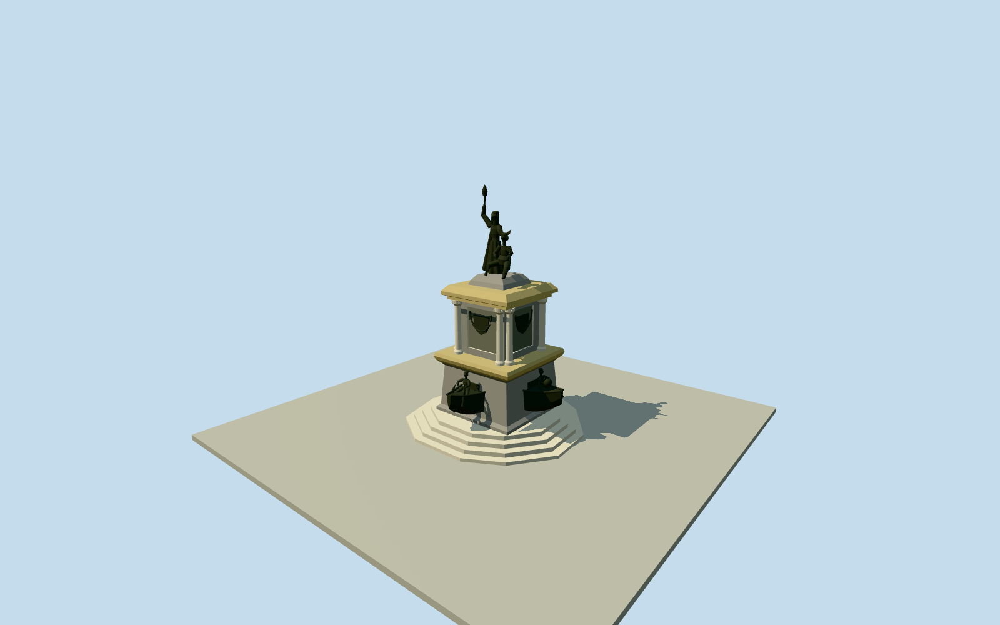

# Opening of the Ports Monument, Manaus

Whole surviving Monumento a Abertura dos Portos/Manaus Q10332121: all11native basecontrols/intrinsic steppedfooting, lower quadrangular granite pedestal with four projecting bronze ship bows and seated boys/continent attributes, eight corner columns around central shield panels, overhanging marble cornices and whole upper bronze Amazon-woman/torch plus lower Mercury sculpture. Marble/graygranite/darkbronze palette from primary1899 contract, original sculptural profiles/anatomy/hiddenattributes/sections not a scan. No surrounding wave-paved plaza, theatre/church, people/trees/bollards/lettering/privateinterior.

Authoring state: **review-in-qa.json**. Current completion evidence is in [qa.json](qa.json) and the [completion ledger](../../../../qualla-structures/batches/qualla-002.PROGRESS.md).

- [Monument Abertura dos Portos](https://qualla.com/monument-abertura-dos-portos/)

Whole monument at nativeway1155910709 in LargoSaoSebastiao,11 unique original controls of broad intrinsic stepped base. Native generic name Sebastiao resolved by exactlocation/scale at Qualla/WikipediaQ10332121 coordinates, distinct nearby churchway794449845 and TeneiroAranha7833502612. Preserve all11base stations in original +Xeast/+Zsouth/heading0 frame; no park/plaza/TeatroAmazonas extrusion. Original1899 government constructioncontract supplies12.5m total height, eight columns and lower/central/upper material/figure roles. Interiorsections, upperpedestalrectangles, sculpturebody/boatprofiles and compassorientation of allegorical groups are original bounded interpretations.

Independent300m129x129/16641sample field andtwo originalrawtiles frozen before allfloors/sections/geometry. Structuralfloor0 relativefixed37.7936m provider datum is an unsurveyed reference, not derived fitting to the monument plaza. Original1899contract12.5moverall/eightcolumns/materialroles retained. Originalfour .22msteps/lowerbody3.55/cornice4.05/centralbody6.95/uppercornice7.6/sculptureplatform8.1/toppair to12.5m estimated from exact1903PDphoto proportions; fourprojecting shipbows/children andcontinentattributes, drapedstandingwomanwithraisedrighttorch/lowerMercury anatomies originalmediumfiinterpretations, not reproduction ofascannedmesh. Native11controlbase unchanged; compassorientation ofsculptural groups and hiddenanatomy unsurveyed. Exactgradecontact unresolved, no fieldfit/flatten/reacquire. Geographicpreview/replaceFootprintfalse.

Whole original11-control intrinsic base/four steps/lowergranitebody/four physical shipbows withseated boys/continent emblems/eight columns/real .09m centralpanel recesses/cornices/two summit bronze figures, womanraisedrighttorch/lowerMercury. Physicalsculpture profiles/anatomy/folds/emblem sections andcompass order are original medium-fi estimates, not photogrammetry or exact portrait. Skyline simplifies anatomical/attribute/column sections but retains whole component vocabulary.

Exact published1208x1696 1903 PDbookphoto only/nativeSHA1matched and personallyinspected. NativePD-scan/PD-1923 plus sourcebookPD-old-auto/death1935/BrownUniversityLibrary1903 NOT_IN_COPYRIGHT record. No modernBY/SA/AIcolorized/ambiguous later photograph pixels, copiedmesh/generatedbitmap/photographictextures. Graygranite/creamtravertine/yellowSienamarble/darkbronze palette from primary1899 constructioncontract; restorationfinish unsurveyed.

Independent300m129x129/16641sourcevalues/two rawTerrariumtiles frozen before floors/geometry. Fixed37.7936m datum/floor0 unsurveyedstructural reference. No groundfit/flatten/reacquire; exactstep/plazacontact unresolved, geographicpreview/replaceFootprintfalse. Diagnosticflatground separate; surroundingplaza/theatre/church/people/vegetation/lettering/privateinteriors excluded.

Build: `node packages/worldgen/scripts/generate-authored-places.mjs --ids=monument_abertura_dos_portos`. Add `--check` to verify exact regeneration. 49572 triangles; 4 materials; no embedded photographs.
