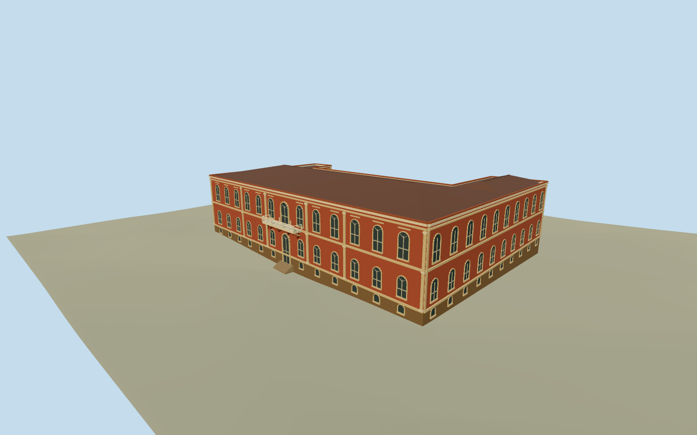

# Provincial Palace

Manaus’s Palacete Provincial, with a long red and cream elevation, rows of arched windows and a central wrought-iron balcony.

Authoring state: **review-in-qa.json**. Current completion evidence is in [qa.json](qa.json) and the [completion ledger](../../../../qualla-structures/batches/qualla-004.PROGRESS.md).

- [Provincial Palace](https://qualla.com/provincial-palace/)

The main historic exterior and connected wings follow the measured outline. The heights, less visible rear openings and rooftop details are estimated. Current exterior colours follow the government description.

Build: `node content/worldgen/source/places/6x/6xm/provincial_palace/models/generate-provincial-palace.mjs`. Add `--check` to verify exact regeneration. 14474 triangles; 5 materials; no embedded photographs.
