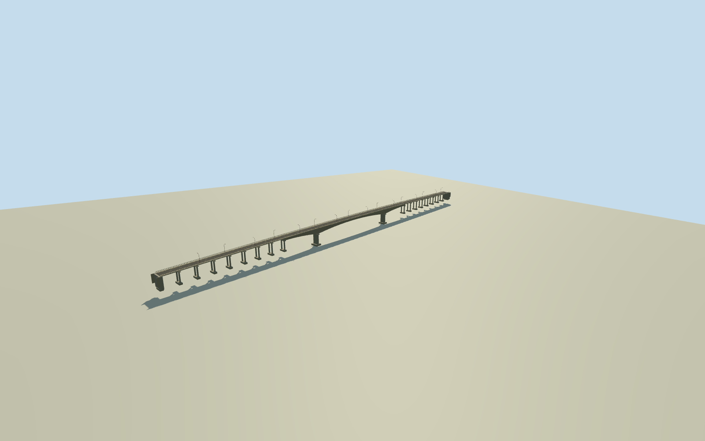

# Juscelino Kubitschek de Oliveira Bridge (2008)

Whole old Juscelino Kubitschek de Oliveira road bridge overTocantins as2008 creatorCC0photographs: all533m crossing, full12.10mwideneddeck/8.20mroadway/twosidewalks/concreteopenbalustrades/curvedlampposts, completeclosedthree-web/two-cellhaunchedprestressedcaisson,140mcentralfreespan/two53mflankspans/centralconcealedhinge, full15–20mapproachspanfamilies/allpiers/bankabutments/footings/underside. ActualhistoricalQ1684949/way153919252/3controls. Wholehiddenapproachcensus/piersections/cablearrangement/grade/haunchregistration areboundedestimates. Exclude2025new630mreplacement/adjacentrailway/collapseeventremains/roadsbeyondabutments/landscape/people/vehicles/signlettering. Do not substitute roadway-onlygenericbeam.

Authoring state: **review-in-qa.json**. Current completion evidence is in [qa.json](qa.json) and the [completion ledger](../../../../qualla-structures/batches/qualla-002.PROGRESS.md).

- [Juscelino Kubitschek de Oliveira Bridge](https://qualla.com/juscelino-kubitschek-de-oliveira-bridge/)

ActualoldbridgeQ1684949/historical2024-12-01way153919252/3centerlinecontrols, distinctQ131560959collapseevent/2025replacement1460511387/separaterailQ10351330. Corridorwidth12.10mderivedprimarytext, notmappedbankorparcel. Primarywholelength533m/140central+53mflanks/15–20mapproachfamily/threewebcaisson/parabolic3.4–8mheight. Nativecenterline registration andwholehiddenpiercensus/sections/haunchstationing/gradeapproximate; all1077reservationsclear.

Whole old Juscelino Kubitschek de Oliveira road bridge overTocantins as2008 creatorCC0photographs: all533m crossing, full12.10mwideneddeck/8.20mroadway/twosidewalks/concreteopenbalustrades/curvedlampposts, completeclosedthree-web/two-cellhaunchedprestressedcaisson,140mcentralfreespan/two53mflankspans/centralconcealedhinge, full15–20mapproachspanfamilies/allpiers/bankabutments/footings/underside. ActualhistoricalQ1684949/way153919252/3controls. Wholehiddenapproachcensus/piersections/cablearrangement/grade/haunchregistration areboundedestimates. Exclude2025new630mreplacement/adjacentrailway/collapseeventremains/roadsbeyondabutments/landscape/people/vehicles/signlettering. Do not substitute roadway-onlygenericbeam.

Independentoriginal1024mfield/frame beforeallfloors/mainsections/geometry. Neverflatten/reacquire/reframe/refitmainsections afterrender.

Primarytext140+53+53=246m, despitearticleprose256m discrepancy. Use explicitspanvalues, no inventedexactsurvey. Whole533mapproachcensus/individualpiergeometry/footings/haunchregistration/roadgrade/oldwaterline estimated.

Primaryjournalphotographs/drawings neverrenderedoradopted; only publishedtextfacts/scalars. Onlytwo unambiguousFernandoownCC0images aremodelimagery.

Wholeold533mbridge represented in2008phase afterwidening/2000externalreinforcement; no2025new630mreplacement orparallelrailway. Primary140mcentralfreespan/flank53mfamily/three-webtwo-cellbox/parabolic3.4–8mdepth fixed. Exactoldpiercensus unknown: allremaining287mapproaches filledwith16regular17.9375mspans asboundedestimatewithinfactual15–20mfamily, not claimedmeasuredsurvey.

Primaryoverallwidened12.10m/8.20mcarriageway/original10m. Photo-guidedopenconcretebalustrades/curvedsingle-armalternatinglamps/raisedwalkways; allcensus/metricdetailing/haunchandpierregistration/externalcablearrangement/oldgrade/waterline estimated. No signlettering/people/vehicles/copiedprotectedjournalart/phototextures.

Independentoriginalfieldcontainsstrongfarfieldnegativecompositevoidartifacts, notbathymetry. Wholeline samplesapprox−2..−8mrelativedatum; foundationsnotextrudedto−740m. Originalfield/frame/allmainsectionsfixedafterthisdocument; no mask/cutout/flattening/reacquisition orfloorfitting. Fullgeometrycheckedisolatedandwithunmaskedfield.

Build: `node content/worldgen/source/places/6y/6yy/juscelino_kubitschek_de_oliveira_bridge/models/generate-house.mjs`. Add `--check` to verify exact regeneration. 35148 triangles; 5 materials; no embedded photographs.
