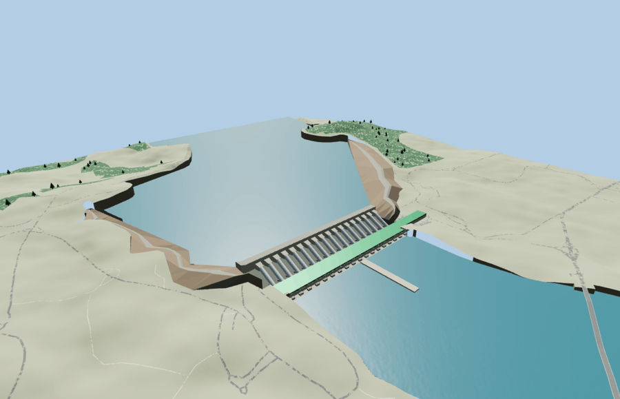

# Belo Monte Dam

The main dam has two rock-fill arms, eighteen exposed penstocks, the complete green-roof generating hall and west wing, a transformer apron, outfall openings, and a channel divider.

The Earth viewer renders the intermediate reservoir at 64.7 m and the Xingu tailrace at 11.7 m. A bounded grade ties the terrain to the west powerhouse apron, and the existing channel opening ends upstream of the native BR-230 bridge. The authored hall replaces the mapped duplicate footprint when it loads.

The Earth fixture retains all three mapped service road records. The ground opening follows the upper central arch. Failed loading preserves the native layers. Eviction restores the ground and releases model geometry.

| Detail level | Triangles | Download bytes | Draws |
| --- | ---: | ---: | ---: |
| skyline | 692 | 67,536 | 1 |
| district | 2,722 | 251,804 | 7 |
| street | 7,132 | 643,260 | 7 |
| closeup | 16,480 | 1,456,944 | 7 |

Skyline and district total 319,340 bytes. Six GLBs pass Khronos validation and contain zero embedded images. Six shared material graphs bind in the near viewer tiers. The review covers 71 renders and 120 geographic samples.

Water levels and local apron grades are representative. Coarse Terrarium slopes leave angular shores around the reservoir and along parts of the tailrace. Penstock diameters and concealed generating equipment are approximate.

This asset covers the main Belo Monte barrier and powerhouse. The linked Pimental complex and diversion canal are separate sites.

[Mapped site frame](map-frame.json) · [Terrain and water fit](site-fit.json) · [QA evidence](qa.json)
