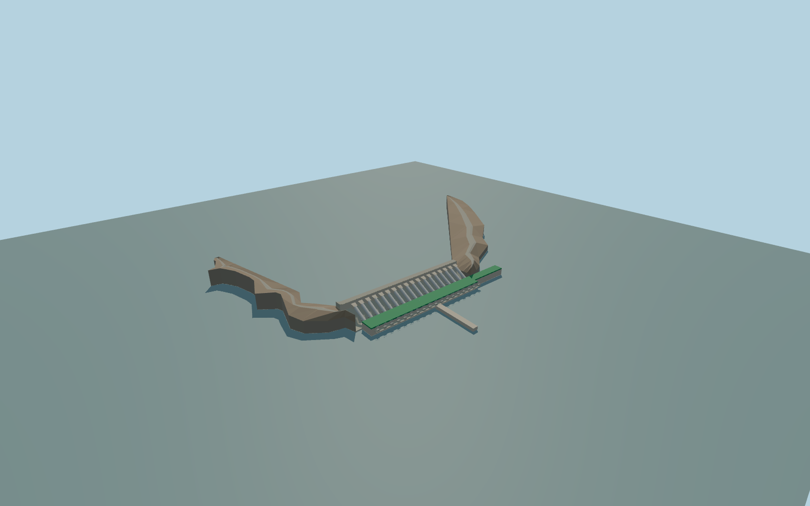

# Belo Monte Dam

Main Belo Monte dam at the retained exact map identity. Both rock-fill arms, intake headwall, eighteen exposed penstocks, the full native green-roof powerhouse including the west wing, river-facing transformer apron, outfall arcade and the mapped tailrace divider.

Rebuild: `node packages/worldgen/scripts/generate-belo-monte-dam.mjs`;append `--check` for exact source bytes. Select import/LOD/placement with `--ids=belo_monte_dam`. Detailed source and four browser tiers are separate ignored GLB outputs.

Main Belo Monte dam at the retained exact map identity. Both rock-fill arms, intake headwall, eighteen exposed penstocks, the full native green-roof powerhouse including the west wing, river-facing transformer apron, outfall arcade and the mapped tailrace divider.

The reservoir datum comes from the standard Terrarium sample at local [0,620]. The layout uses the exact retained dam polygon and the single current PMTiles powerhouse footprint. Elevations, pipe diameters and grades are picture and standard-terrain estimates. The supplier confirms eighteen main units, and the aerial identifies the exposed penstock arrangement. The separately located Pimental site and diversion corridor are outside this main-dam reconstruction.

The signed exact main-dam outline and native hall polygon establish the horizontal footprint. The supplier confirms eighteen main units. Pipe spacing, outlet section, transformer equipment and crest and tailwater levels are visual estimates. Pimental and the diversion corridor remain separately scoped. Physical-device and dense-scene timings remain unmeasured.

The near tailrace correction follows the mapped channel polygon from the powerhouse to local Z -1080. The first native render exposed raised terrain within the photographed water corridor. The correction stops before the separate highway bridge and retains the mapped divider, banks and river beyond this channel reach. Tailwater is illustrative.

Original geometry:repository license. Map:© OpenStreetMap contributors,ODbL-1.0;Protomaps. Standard terrain:terrain-grid.json. Ordinary pictures stay local and are not redistributed or used as textures. Current acceptance:qa.json.
