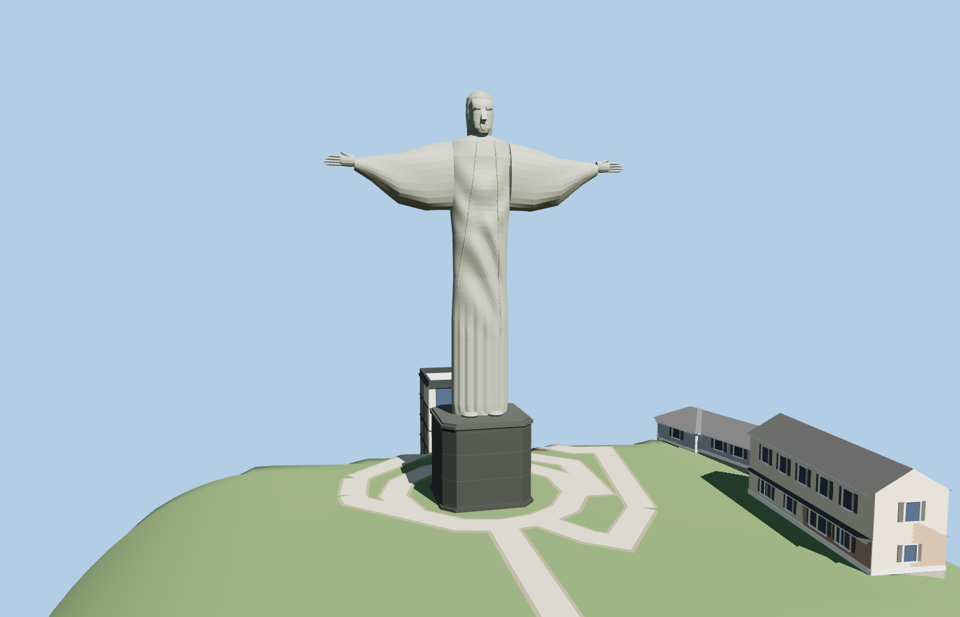

# Christ the Redeemer

**Ready.** Reviewed 2026-11-18.

The statue and octagonal chapel pedestal use original geometry and shared raw limestone, granite and painted metal. The retained PMTiles attraction fixes the location. The ENE facing agrees with the signed front viewing path within 0.5°. [Map frame](map-frame.json)

The stock terrain grade uses the mapped 710 m peak and 688 m restaurant terrace as separate controls. The pedestal sits flush with the upper terrace. The grade blends back into the original ridge beyond the site and retains the mapped paths, stairs and buildings. Exact terrace transitions and unmapped rock relief remain approximate. [Placement evidence](placement-report.json)

All four detail levels were inspected in the stock Earth renderer. The failed-load fallback keeps the summit and its mapped features visible. Six GLBs validate with no embedded images, and the four browser levels rebuild byte for byte. The skyline and district levels total 335,612 bytes. [QA](qa.json)
