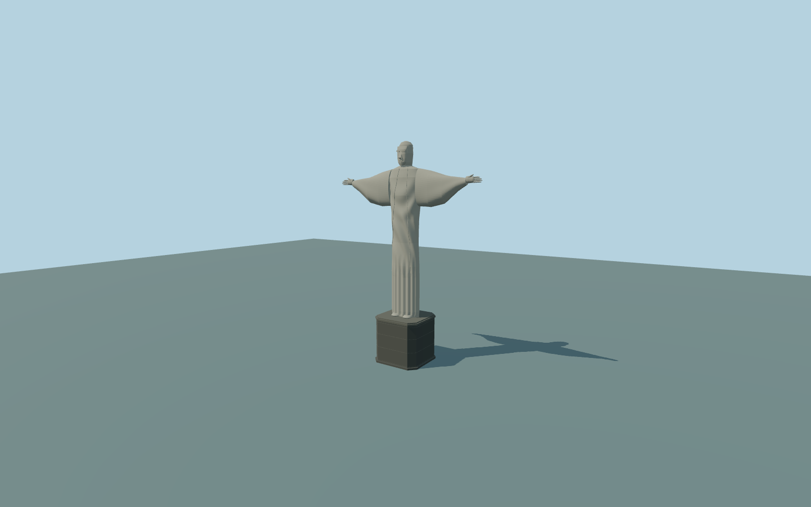

# Christ the Redeemer

Complete individual medium-fi Christ the Redeemer monument and integral octagonal chapel pedestal:long draped robe with lower vertical pleats and original asymmetric mantle/chest folds,closed head/face/neck and hair,extended closed sleeves,palms/fingers/thumbs,paired feet,beveled dark pedestal coping andclosed approximate rear chapel door. Surrounding viewing terraces,railings,stairs,lifts,station,restaurants andmountain remain native context;no copied inscription orinterior.

Rebuild: `node packages/worldgen/scripts/generate-christ-redeemer.mjs`;append `--check` for exact source bytes. Select import/LOD/placement with `--ids=christ_the_redeemer`. Detailed source and four browser tiers are separate ignored GLB outputs.

The stock grade fits the named PMTiles summit and restaurant elevations. Terrace transitions and the unmeasured rock profile are visual approximations.

The ENE facing follows the signed viewing path and the ordinary photos. The pedestal and figure use observed proportions and simplified facial, hand and rear details.

The original exterior covers the statue and integral octagonal chapel pedestal. The mapped stairs, paths, station, restaurants and independent buildings retain their native representations.

Original geometry:repository license. Map:© OpenStreetMap contributors,ODbL-1.0;Protomaps. Standard terrain:terrain-grid.json. Ordinary pictures stay local and are not redistributed or used as textures. Current acceptance:qa.json.
