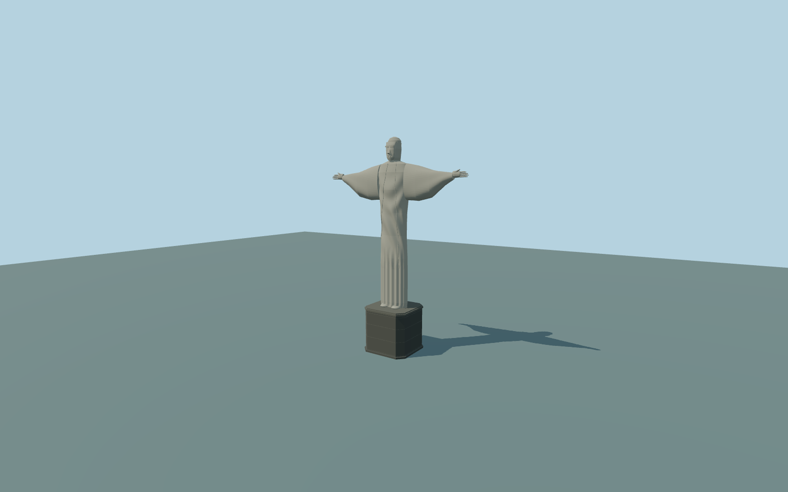

# Christ the Redeemer

Complete individual medium-fi Christ the Redeemer monument and integral octagonal chapel pedestal:long draped robe with lower vertical pleats and original asymmetric mantle/chest folds,closed head/face/neck and hair,extended closed sleeves,palms/fingers/thumbs,paired feet,beveled dark pedestal coping andclosed approximate rear chapel door. Surrounding viewing terraces,railings,stairs,lifts,station,restaurants andmountain remain native context;no copied inscription orinterior.

Rebuild: `node packages/worldgen/scripts/generate-christ-redeemer.mjs`;append `--check` for exact source bytes. Select import/LOD/placement with `--ids=christ_the_redeemer`. Detailed source and four browser tiers are separate ignored GLB outputs.

Complete individual medium-fi Christ the Redeemer monument and integral octagonal chapel pedestal:long draped robe with lower vertical pleats and original asymmetric mantle/chest folds,closed head/face/neck and hair,extended closed sleeves,palms/fingers/thumbs,paired feet,beveled dark pedestal coping andclosed approximate rear chapel door. Surrounding viewing terraces,railings,stairs,lifts,station,restaurants andmountain remain native context;no copied inscription orinterior.

Retained Wikidata facts give30.1m statue and8m pedestal;source top38.1m above the authored pedestal base. Arm span28.3m,depth,original face/folds/hands,hidden rear inventory andchapel door are picture-proportioned medium-fi approximations. Place the Y=0 base relative to the current host terrain,not at an asserted surveyed710m altitude. The standard global field center is528.95m andsmooths the sharp Corcovado summit;native peak POI710m remains a separate fact. No fabricated mountain orsite survey.

Two actually inspected ordinary front/side aerial pictures andcurrent standard PMTiles. Original geometric interpretation of the monument,not an exact sculpture scan. Approximate ENE front-facing direction with10-degree uncertainty. Shared raw limestone graph tinted gray-green approximates its pale small-mosaic surface. Monument-only site scope excludes wide viewing terraces,balustrades,access stairs/ramps andindependent context. Native terrain fit is approximate;physical-device timings andnumerical LOD error are unmeasured.

Three existing shared256px raw limestone,granite andpainted-metal graphs;three groups maximum,metric UVs/linear colors,no private orembedded images. Skyline retains closed silhouette,arms/hands/head/feet andoctagonal pedestal;district adds closed original face andseparate fingers;street adds geometric mantle/pleats;close-up refines those curves. Detailed source remains separate.

Original geometry:repository license. Map:© OpenStreetMap contributors,ODbL-1.0;Protomaps. Standard terrain:terrain-grid.json. Ordinary pictures stay local and are not redistributed or used as textures. Current acceptance:qa.json.
