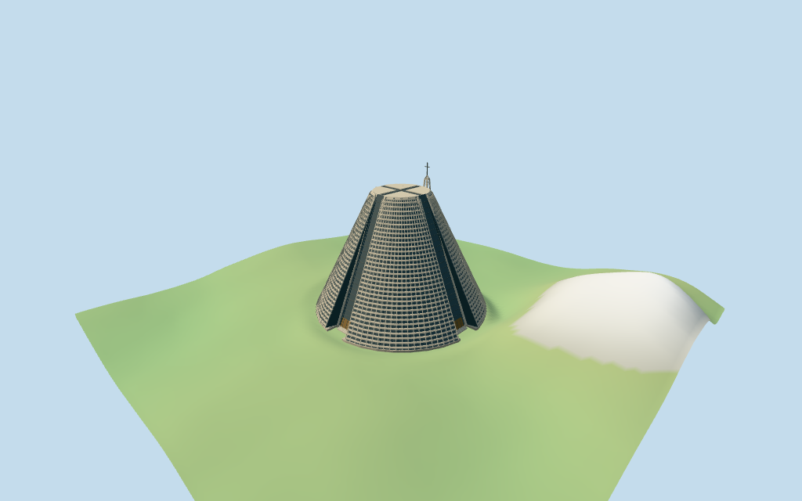

# Rio de Janeiro Cathedral

Individual Rio Metropolitan Cathedral: mapped approximately107m diameter,75m high gray-brown concrete truncated cone with four inset full-height window axes, broad sloping concrete borders, repeated horizontal louvers and sparse radial ribs, flat crown rim/cross skylight and four recessed bronze portals. Separate open tapering concrete campanile on mapped round base, six open stages with selected suspended bells and75m cross. Three shared256-square concrete/boardformed-concrete/cast-bronze graphs, metric UVs, linear tints, flat normals and four authored browser levels. Exact glass artwork, portal sculpture, statues, interiors, engineering members and surveyed plaza/threshold grading excluded.

## Evidence and reconstruction

Published dimensions and reconstructed details are separated in spec.json. Primary references:

- [Reference](https://commons.wikimedia.org/wiki/File:Catedral_Rio_de_Janeiro.jpg)
- [Reference](https://commons.wikimedia.org/wiki/File:Centro_do_Rio_de_Janeiro_by_Diego_Baravelli.jpg)

Three cached256-square plain concrete, boardformed concrete and cast bronze graphs. Linear warm concrete/dark blue-gray glass tints, metric UVs and flat architectural normals. No embedded images, unique facade textures or baked shadows.

## Model and axes

20,022 triangles; 60,066 vertices; 5 material groups; 2,405,848 bytes. Native bounds: -57.620, -9.877, -87.820 to 54.052, 75.600, 53.833. Source hash: `sha256:9b410b1841ed9fa3f2fefff6625a8e4f940a456c4e57bca55ff2dd68d4c7781b`.

{"x":"east-northeast along paired window axes","y":"up","z":"south-southeast along other paired window axes"}

Standard viewer DEM datum 17.295082m; source floor0.6m, raw whole perimeter -9.53..8.09m. Retained raw urban DEM has about18m local variation; source review uses an explicitly bounded estimated plaza grade near0.2m around the cathedral and campanile, blending into raw terrain. This fixture is not applied to host terrain. Runtime placement uses terrain-contact at the anchor; base clipping/sinking on noisy host DEM, exact plaza/door joins, absolute altitude and walking remain unverified. Footings extend below coarse samples; no global terrain flattening or road replacement.

## Reproduce

Run `node packages/worldgen/scripts/generate-additional-landmarks.mjs --ids=N0378` (or add `--check`). The generator preserves manually edited masters by checking their baseline hashes. Import through the standard authored-model workflow with optimization disabled; then capture all QA cameras, including shared-surface views.

## Pending work

- Retained exact-QID OSM way30621926/Q2411716 matches current main35184402710758: 48 raw vertices and mapped75m height. Upper20-vertex part35184665300982 retains min_height50m/height75m and supplies the approximately33m crown diameter; it is not extruded as a cylinder from ground. Main diameter is approximately107m (retained width/length facts106m). Separate16-vertex circle35184553463044 with height75m matches the open campanile in two inspected pictures, centered at[-50.58970495468355,-80.74536811878683]m. All three raw controls/tags and earlier multilingual metadata are retained. Four inset window axes follow the main notches, signed by the detached northwestern campanile. Frustum slope, concrete grille rhythm/beam thickness, skylight cross, doors, tower legs/stages/bells and cross proportions are picture estimates. Mapped tower75m is treated as its total envelope including cross; exact sub-heights are unverified.
- Standard viewer DEM datum 17.295082m; source floor0.6m, raw whole perimeter -9.53..8.09m. Retained raw urban DEM has about18m local variation; source review uses an explicitly bounded estimated plaza grade near0.2m around the cathedral and campanile, blending into raw terrain. This fixture is not applied to host terrain. Runtime placement uses terrain-contact at the anchor; base clipping/sinking on noisy host DEM, exact plaza/door joins, absolute altitude and walking remain unverified. Footings extend below coarse samples; no global terrain flattening or road replacement.
- Medium-fi exterior from two inspected2012/2016 pictures and standard viewer PMTiles/DEM. Concrete grille and glass artwork are simplified into merged bands/ribs and opaque dark glazing; no sculptural portal panels, statues or full interiors. Exact current finish, hidden portal details and bell shapes/heights remain approximate. Source-only bounded plaza grade is not a host terrain correction; noisy raw DEM can obscure the real runtime base. Physical laptop/phone measurements pending.
- Skyline preserves mapped truncated-cone/crown/window-axis massing and detached cross-topped campanile. District adds shared surfaces/coarse merged grille and open bell stages. Street refines concrete tiers/ribs, portal frames and selected bells; closeup/master refine rhythm. Synthetic cottages are review fixtures.

This bundle follows the medium-fi standard. Medium-fi appearance and geographic fit are reviewed separately. Hash-bound visual acceptance is recorded separately after capture inspection.

## Additional geographic data

©OpenStreetMap contributors; Protomaps; Mapzen/USGS terrain tiles.
