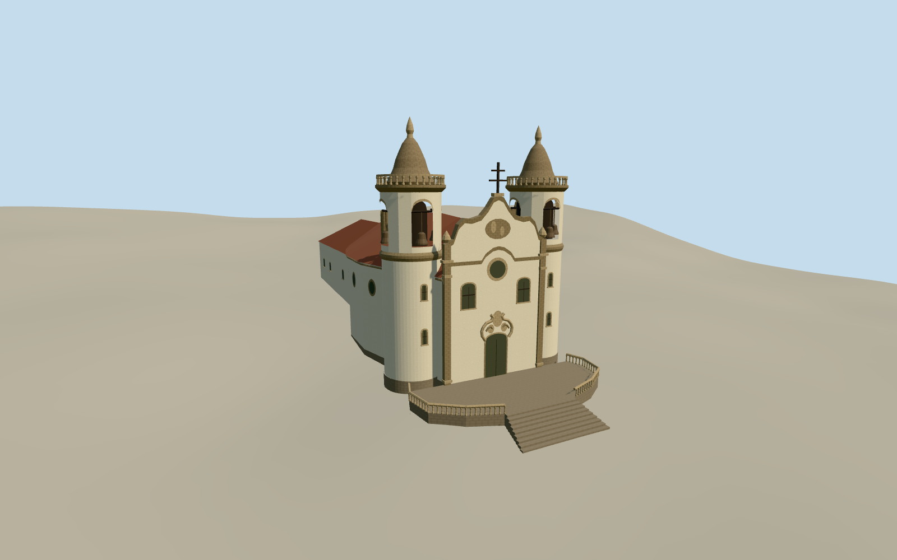

# Church of Saint Francis of Assisi, São João del-Rei

The standing Rococo church of São Francisco de Assis, with its round bell towers, stone frontispiece, curved nave and terracotta roofs.

Authoring state: **review-in-qa.json**. Current completion evidence is in [qa.json](qa.json) and the [completion ledger](../../../../qualla-structures/batches/qualla-003.PROGRESS.md).

- [Church of Saint Francis of Assisi (Sao Joao del-Rei)](https://qualla.com/church-of-saint-francis-of-assisi-sao-joao-del-rei/)

Standing exterior reconstruction. Tower diameters and roof sections, individual stone carvings and window finish are approximate.

The church envelope is mapped. Its curving sides and the later steps and forecourt are reconstructed from published architectural descriptions.

The original terrain establishes local relief, with approximate floor and forecourt contact. The cemetery remains outside the model scope.

Build: `node content/worldgen/source/places/7h/7h0/church_of_saint_francis_of_assisi_sao_joao_del_rei/models/generate-sao-joao-del-rei-sao-francisco.mjs`. Add `--check` to verify exact regeneration. 17002 triangles; 6 materials; no embedded photographs.
