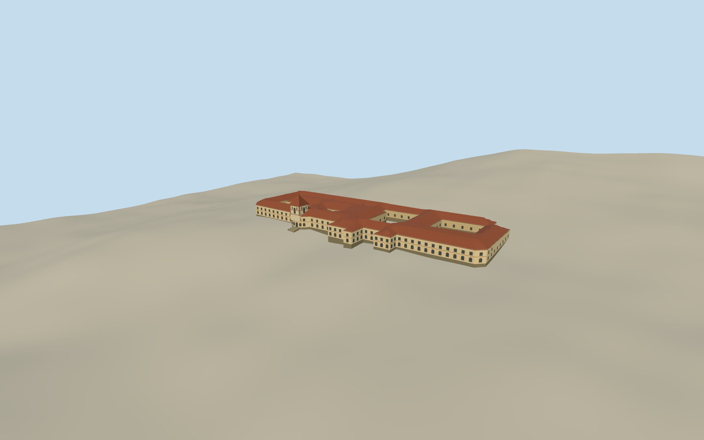

# Hospital Colônia de Barbacena

The former Hospital Colônia headquarters and connected ranges, with a rounded museum frontage, the two-storey Torreão, tiled roofs and six open internal courts.

Authoring state: **review-in-qa.json**. Current completion evidence is in [qa.json](qa.json) and the [completion ledger](../../../../qualla-structures/batches/qualla-003.PROGRESS.md).

- [Hospital Colônia de Barbacena](https://qualla.com/hospital-colonia-de-barbacena/)

The connected exterior and six open courts are based on the native mapped building. The museum lies at the rounded northeastern projection.

The 1921 archive documents a tiled pavilion on the grounds. The tower itself is based on the official museum identity, the two-storey description and the mapped plan. Roof breaks, exterior finishes, tower crown and opening details are estimated.

The historic model covers the main connected building and its museum wing. Finished architectural levels, exact thresholds and grade contact are approximations.

Build: `node content/worldgen/source/places/7h/7h0/hospital_colonia_de_barbacena/models/generate-hospital-colonia-de-barbacena.mjs`. Add `--check` to verify exact regeneration. 8544 triangles; 5 materials; no embedded photographs.
