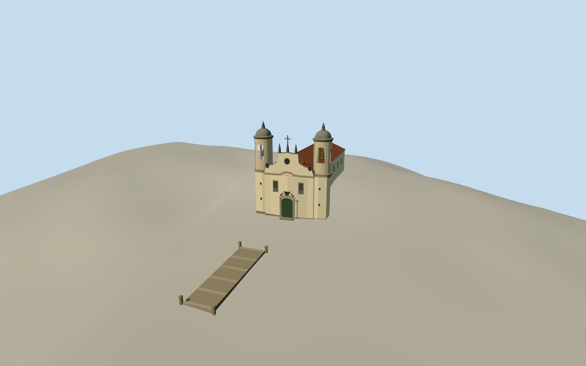

# Church of Our Lady of Mount Carmel (Ouro Preto)

The standing Rococo church of Our Lady of Mount Carmel in Ouro Preto, with rounded twin belfries, a sculpted and curved front, a terracotta roof and a long hillside stair.

Authoring state: **review-in-qa.json**. Current completion evidence is in [qa.json](qa.json) and the [completion ledger](../../../../qualla-structures/batches/qualla-003.PROGRESS.md).

- [Church of Our Lady of Mount Carmel (Ouro Preto)](https://qualla.com/church-of-our-lady-of-mount-carmel-ouro-preto/)

The native postcard is monochrome. The pale plaster, sandstone trim, painted wood and terracotta are approximate colors, informed by historic materials.

Stone relief, carved escutcheon, tower crossfalls, rear openings and roof details are modeled at medium fidelity. No interior or garden furnishing is modeled.

The source field resolves the hill and slope. It cannot resolve individual steps or certify survey-grade positioning. The stair width, tread count and foundation contacts are estimates.

Build: `node content/worldgen/source/places/7h/7h3/church_of_our_lady_of_mount_carmel_ouro_preto/models/generate-church-of-our-lady-of-mount-carmel-ouro-preto.mjs`. Add `--check` to verify exact regeneration. 5850 triangles; 7 materials; no embedded photographs.
