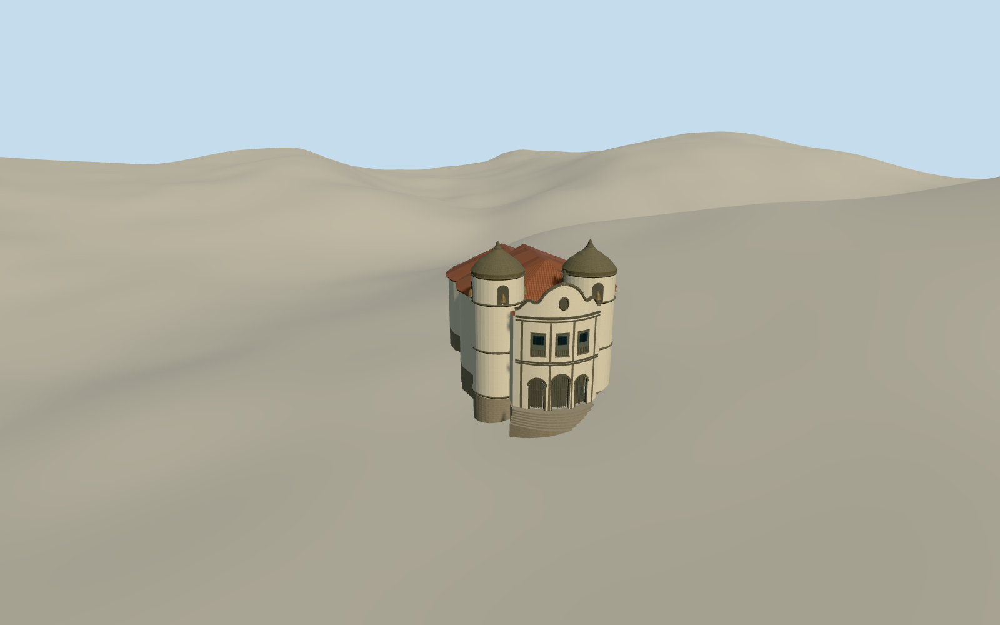

# Church of Our Lady of the Rosary of Black Men (Ouro Preto)

The Rosário church in Ouro Preto with a curved three-arched façade, paired round bell towers and interlocking oval tile roofs.

Authoring state: **review-in-qa.json**. Current completion evidence is in [qa.json](qa.json) and the [completion ledger](../../../../qualla-structures/batches/qualla-003.PROGRESS.md).

- [Church of Our Lady of the Rosary of Black Men (Ouro Preto)](https://qualla.com/church-of-our-lady-of-the-rosary-of-black-men-ouro-preto/)

The footprint fixes the double-oval plan, rear volume and tower projections. Exact roof and bell-tower heights, the profiles of the curved front and details of the attachment are estimates.

The municipal sources identify the materials and principal architectural forms. Finish colors, roof tile layout, the relief shapes, opening details and staircase dimensions are simplified estimates.

The church comprises the modeled asset. Nearby dwellings, the fountain and the other Rosário church in Ouro Preto are separate landmarks.

The entrance level is placed slightly above the original elevation samples across the three openings. The outer steps meet the sloping terrain at different heights.

Build: `node content/worldgen/source/places/7h/7h3/church_of_our_lady_of_the_rosary_of_black_men_ouro_preto/models/generate-church-of-our-lady-of-the-rosary-of-black-men-ouro-preto.mjs`. Add `--check` to verify exact regeneration. 8390 triangles; 8 materials; no embedded photographs.
