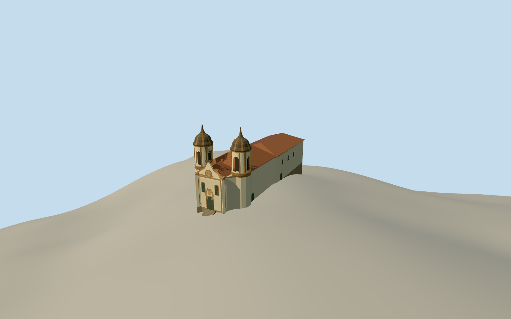

# Church of Saint Francis of Assisi, Ouro Preto

The standing Rococo church of São Francisco de Assis, with its warm stone frontispiece, two round recessed belfries, and terracotta nave and chancel roofs.

Authoring state: **review-in-qa.json**. Current completion evidence is in [qa.json](qa.json) and the [completion ledger](../../../../qualla-structures/batches/qualla-003.PROGRESS.md).

- [Church of Saint Francis of Assisi (Ouro Preto)](https://qualla.com/church-of-saint-francis-of-assisi-ouro-preto/)

The present church’s 32-point footprint, round belfry bases and entrances follow OpenStreetMap. Standing upper levels, masonry joints and unseen roof transitions are architectural estimates.

The 2023 creator-dedicated exterior establishes visible palette, stone contrast, shutters, Rococo crest and the recessed towers. Fine religious relief is simplified.

The original terrain shows a substantial slope behind the standing church. Footing contact, steps and individual visible stone courses are approximate.

Build: `node content/worldgen/source/places/7h/7h3/church_of_saint_francis_of_assisi_ouro_preto/models/generate-ouro-preto-sao-francisco.mjs`. Add `--check` to verify exact regeneration. 4720 triangles; 6 materials; no embedded photographs.
