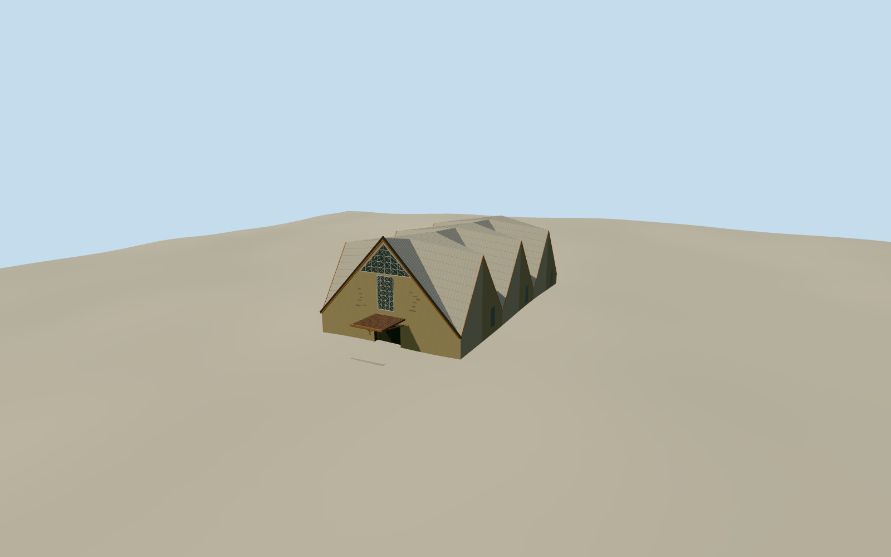

# Saint Sebastian Cathedral, Coronel Fabriciano

The 2010 Saint Sebastian Co-Cathedral in Coronel Fabriciano with its folded tent-like roof, ochre gable, geometric glass framing and covered entry.

Authoring state: **review-in-qa.json**. Current completion evidence is in [qa.json](qa.json) and the [completion ledger](../../../../qualla-structures/batches/qualla-003.PROGRESS.md).

- [Saint Sebastian Cathedral, Coronel Fabriciano](https://qualla.com/saint-sebastian-cathedral-coronel-fabriciano/)

The model represents the modern Santa Helena cathedral as photographed in June 2010, with the weathered tan frontage of that date.

The named outline and street constrain the plan. The original photograph controls the broad glass triangle, geometric grille, warm roof edging and lower porch. Side fold proportions and rear openings are reconstructed estimates based on the parish description.

The original Terrarium field is preserved. The terrace and paving contact are approximate.

Build: `node content/worldgen/source/places/7h/7h9/saint_sebastian_cathedral_coronel_fabriciano/models/generate-fabriciano-cathedral.mjs`. Add `--check` to verify exact regeneration. 4743 triangles; 5 materials; no embedded photographs.
