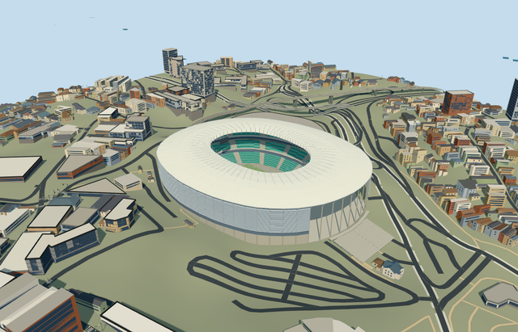

# arena_fonte_nova — Arena Fonte Nova

Reviewed2026-10-20 in one author/build/inspect/fix pass.

## Appearance

Inspected48 final current source, shared-material, medium-fi and native views. Specific renovated Fonte Nova oval pale membrane/closed underside/inner compression ring/exposed radial members and cable masts, three green banks/pale aisles/closed club belts, southern seating break with restaurant bridge and visible field-level opening toward the lake, horizontal outer louvers/original-contact columns/lower services, local south approach steps and attached native entrance strip, open neutral football field/goals and two hanging displays. Corrected distant angular sampling so the south opening remains visible in every level. One continuous author/build/inspect/fix pass; no copied lettering/sponsor graphics, crowd or hidden furnished rooms.

## Shared surfaces and browser budgets

Four existing256px graphs: concrete_plain, metal_painted, window_grid and fabric_canvas. Concrete, green seating/metal/louvers, glazing, pale membrane/apron/turf reuse the library. Four near draws/one skyline draw; no new graph, embedded image or private atlas. Each graph read once; separate POSITION/NORMAL streams and equal CPU/GPU accounting. Shared opaque fabric/glazing approximate fine weave/transmission. Flat synthetic contexts can hide downslope stair bottoms; the native sloping-terrain views establish their placement.

| Level | Triangles | Bytes | Draws |
| --- | ---: | ---: | ---: |
| skyline | 750 | 63680 | 1 |
| district | 2860 | 253852 | 4 |
| street | 14430 | 1266136 | 4 |
| closeup | 60342 | 5475500 | 4 |

Four authored browser levels retain the continuous oval roof/open aperture, green three-bank horseshoe and southern opening/restaurant belt. Louvers, rows, cable masts, near field marks/goals and stair rails appear near. Levels 750/2860/14430/60342triangles; initial skyline plus district317532bytes, below3MB phone/6MB laptop initial asset targets. Physical ordinary-laptop/phone/tablet and dense-city timings remain pending.

## Approximate native placement

Retained Q6499360 and named native Casa de Apostas Arena Fonte Nova POI52776561479861 establish stadium parent52776561479861 and integrated south entrance-canopy strip35185526867760. Only these two owned records are replaced. Separate pitch35184620593198 supplies105.072780x59.075187m mapped field and axis; these map proportions are retained rather than certified as regulation dimensions. Native38-point outer/28-point roof opening control the approximately271x227m envelope and135x94m roof aperture. Anchor[-38.50426375865936,-12.978828636190258]/heading0/native east-south/internal X[0.019386938491681473,0.9998120556464198]/Z[-0.9998120556464198,0.019386938491681473]. Positive internal X points south toward the lake and the photographed open seating break. Fine20degree/2m facing remains approximate. All independent buildings, especially the garage to the northeast, remain native. Production helper replaces only own stadium parent52776561479861 and integrated southern entrance strip35185526867760. All1337 independent resident records of1339 originals/all2875 wider independent records of2877 remain unchanged, including the separate northeast garage, ticket/utility buildings and neighborhood. Original6m samples, roads and119076.22539995259square metres native lake/water remain unchanged. Five actual PMTiles13/14/15 cases pass; detailed records use99.5percent ownership coverage and generalized complexes bounded clipping. Failure retains1339 originals; every level unload restores terrain/water/zero live model geometry. Original standard6m Mapzen grid, roads, lake and every independent building remain unchanged. Datum36.752336730748624m defines field/modelY0; own boundary samples span-4.793902576630785..15.867745853967847m. Main bounded ground opening stays within occupied retaining floors; apron and field are partitioned without overlapping hidden caps. Columns/entrance posts reach original grades, local south stairs follow original descending samples. Only stadium and attached entrance-canopy strip are replaced at99.5percent detailed coverage; generalized complexes use bounded clipping. No whole precinct/parking slab or terrain flattening. Failure/unload retains/restores original context. A prose-only ownership correction replaced an inherited landmark name in buildingCutout.basis. All render-affecting scope values, source/runtime/LOD bytes and native controls remain identical. Forty recaptured source/shared/medium frames are byte-identical to the previously inspected images; the eight unchanged-input native frames retain their inspection.

## Limits

Three ordinary2013 photographs actually viewed: David Campbell aerial establishes continuous oval envelope/lake/city context; November David Campbell exterior establishes the southern opening/horizontal louvers/columns/approach steps; August SCHULITZ Architekten interior establishes green banks/restaurant crossing the opening/cable roof and hanging display. Photos viewed only/no copied pixels. Existing renovated2013 configuration; demolished predecessor, temporary event art and future proposals excluded. Native20m stadium height has unqualified datum and is retained as evidence, not substituted for roof clearance. Working fieldY0 uses original datum36.752336730748624m. Picture-led lower bank1.4..12m/middle16..24m/upper29..43m, club belt12..16m and restaurant bridge26..29m; roof inner48m/outer45m/curved fabric crown approximately50m/mast53m. Original-contact columns, lower services, eighteen near louvers, near row/frame/mast/roof-panel inventory and south stairs remain picture-led allocations. Existing renovated2013 configuration, not surveyed dimensions, structural/access/optical or furnished-interior certification.

## Selected checks

Six Khronos files: zero errors/warnings.742 actual geometry/material/contact checks,48 current inspected views,5 actual native map-level cases. Selected source/import/placement/strict medium-fi/scene validation/lint pass. Sim30 hash25b05a5399d34c0de0ed097d9d74078179e094dfd2f1ab4f3ede6c9acec31eaf.

Source sha256:6e776cfc4e0c9345bfefceffa94f24594f6bc287b07556fa0010abd9e7e83c2f

Runtime sha256:45974ca5f27f159db3922e75b425d34317b478f0f85714efb5cb1ed897178295

Input sha256:05bc80d8626286f475cce38529ee768c6a442791b19bf9071a7f6832dc26fcd2

Rebuild: node packages/worldgen/scripts/generate-additional-landmarks.mjs --ids=arena_fonte_nova; node packages/worldgen/scripts/import-structure-models.mjs --ids=arena_fonte_nova; node packages/tooling/scripts/generate-landmark-lods.mjs --ids=arena_fonte_nova --force.

## Ordinary picture references

https://commons.wikimedia.org/wiki/File:Arena_Fonte_Nova,_aerial_view.jpg — https://thumb.wikimedia.org/wikipedia/commons/thumb/2/26/Arena_Fonte_Nova%2C_aerial_view.jpg/960px-Arena_Fonte_Nova%2C_aerial_view.jpg; David Campbell; CC-BY-3.0-BR; viewed only/no copied pixels. Viewed only/no copied pixels.

https://commons.wikimedia.org/wiki/File:Arena_Fonte_Nova_External_View.jpg — https://thumb.wikimedia.org/wikipedia/commons/thumb/3/35/Arena_Fonte_Nova_External_View.jpg/960px-Arena_Fonte_Nova_External_View.jpg; Faquini Produção Fotográfica; David Campbell; CC-BY-3.0-BR; viewed only/no copied pixels. Viewed only/no copied pixels.

https://commons.wikimedia.org/wiki/File:Arena_Fonte_Nova_Southern_Opening.jpg — https://thumb.wikimedia.org/wikipedia/commons/thumb/9/94/Arena_Fonte_Nova_Southern_Opening.jpg/960px-Arena_Fonte_Nova_Southern_Opening.jpg; SCHULITZ Architekten; CC-BY-SA-3.0-DE; viewed only/no copied pixels. Viewed only/no copied pixels.
