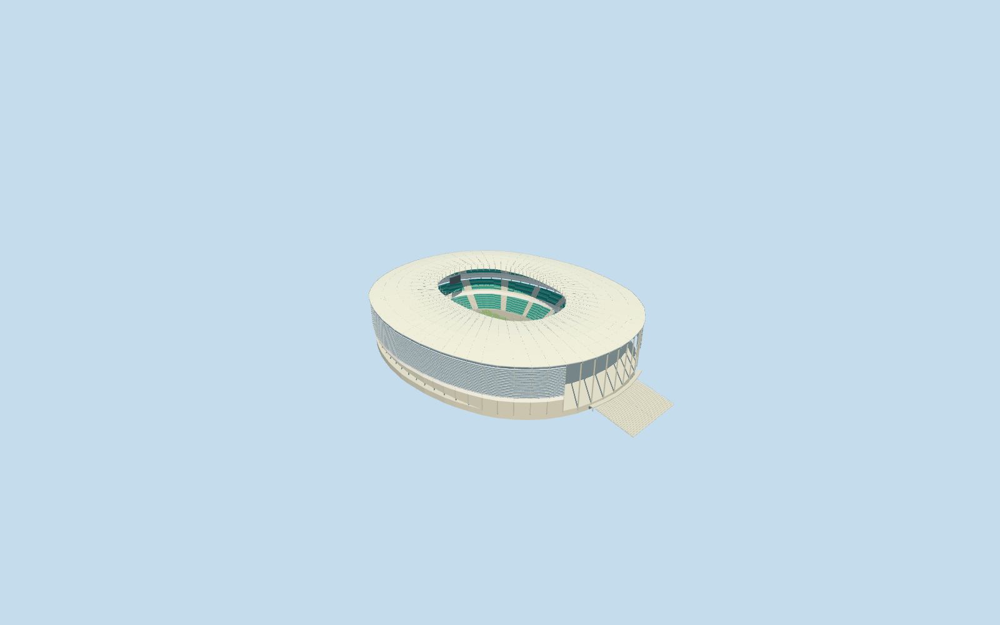

# Arena Fonte Nova

Specific renovated Arena Fonte Nova: continuous oval pale membrane roof/closed underside/inner ring/exposed radial frame and cable masts, horseshoe three-bank green bowl/pale aisles, closed club belts and glazed restaurant bridge above the open southern field-level view toward the lake. Native-plan outer louvers/exposed original-ground columns/base services, attached entrance strip and local south approach steps, open neutral football floor/goals and two hanging neutral displays. No copied lettering, sponsor artwork, crowd or private texture. Separate Edificio Garagem, utility/ticket buildings, lake, roads and neighborhood remain native. Demolished predecessor, future proposals and temporary event installations excluded.

## Evidence and reconstruction

Published dimensions and reconstructed details are separated in spec.json. Primary references:

- [Reference](https://commons.wikimedia.org/wiki/File:Arena_Fonte_Nova,_aerial_view.jpg)
- [Reference](https://commons.wikimedia.org/wiki/File:Arena_Fonte_Nova_External_View.jpg)
- [Reference](https://commons.wikimedia.org/wiki/File:Arena_Fonte_Nova_Southern_Opening.jpg)

Specific renovated Arena Fonte Nova: continuous oval pale membrane roof/closed underside/inner ring/exposed radial frame and cable masts, horseshoe three-bank green bowl/pale aisles, closed club belts and glazed restaurant bridge above the open southern field-level view toward the lake. Native-plan outer louvers/exposed original-ground columns/base services, attached entrance strip and local south approach steps, open neutral football floor/goals and two hanging neutral displays. No copied lettering, sponsor artwork, crowd or private texture. Separate Edificio Garagem, utility/ticket buildings, lake, roads and neighborhood remain native. Demolished predecessor, future proposals and temporary event installations excluded.

## Model and axes

60,342 triangles; 181,026 vertices; 4 material groups; 7,243,992 bytes. Native bounds: -113.796, -7.137, -131.712 to 113.637, 53.060, 176.558. Source hash: `sha256:6e776cfc4e0c9345bfefceffa94f24594f6bc287b07556fa0010abd9e7e83c2f`.

{"x":"east","y":"up","z":"south"}

The geographic proposal uses exact-QID OpenStreetMap evidence. Map-derived orientation and estimated architectural details require real-site visual review; preview eligibility is distinct from geographic/fidelity approval. Map attribution: © OpenStreetMap contributors, ODbL-1.0.

## Reproduce

Run `node packages/worldgen/scripts/generate-additional-landmarks.mjs --ids=N0734` (or add `--check`). The generator preserves manually edited masters by checking their baseline hashes. Import through the standard authored-model workflow with optimization disabled; then capture all QA cameras, including shared-surface views.

## Pending work

- Specific renovated Arena Fonte Nova: continuous oval pale membrane roof/closed underside/inner ring/exposed radial frame and cable masts, horseshoe three-bank green bowl/pale aisles, closed club belts and glazed restaurant bridge above the open southern field-level view toward the lake. Native-plan outer louvers/exposed original-ground columns/base services, attached entrance strip and local south approach steps, open neutral football floor/goals and two hanging neutral displays. No copied lettering, sponsor artwork, crowd or private texture. Separate Edificio Garagem, utility/ticket buildings, lake, roads and neighborhood remain native. Demolished predecessor, future proposals and temporary event installations excluded.
- Retained Q6499360 and named native Casa de Apostas Arena Fonte Nova POI52776561479861 establish stadium parent52776561479861 and integrated south entrance-canopy strip35185526867760. Only these two owned records are replaced. Separate pitch35184620593198 supplies105.072780x59.075187m mapped field and axis; these map proportions are retained rather than certified as regulation dimensions. Native38-point outer/28-point roof opening control the approximately271x227m envelope and135x94m roof aperture. Anchor[-38.50426375865936,-12.978828636190258]/heading0/native east-south/internal X[0.019386938491681473,0.9998120556464198]/Z[-0.9998120556464198,0.019386938491681473]. Positive internal X points south toward the lake and the photographed open seating break. Fine20degree/2m facing remains approximate. All independent buildings, especially the garage to the northeast, remain native.
- Native20m stadium height has unqualified datum and is retained as evidence, not substituted for roof clearance. Working fieldY0 uses original datum36.752336730748624m. Picture-led lower bank1.4..12m/middle16..24m/upper29..43m, club belt12..16m and restaurant bridge26..29m; roof inner48m/outer45m/curved fabric crown approximately50m/mast53m. Original-contact columns, lower services, eighteen near louvers, near row/frame/mast/roof-panel inventory and south stairs remain picture-led allocations. Existing renovated2013 configuration, not surveyed dimensions, structural/access/optical or furnished-interior certification.
- Original standard6m Mapzen grid, roads, lake and every independent building remain unchanged. Datum36.752336730748624m defines field/modelY0; own boundary samples span-4.793902576630785..15.867745853967847m. Main bounded ground opening stays within occupied retaining floors; apron and field are partitioned without overlapping hidden caps. Columns/entrance posts reach original grades, local south stairs follow original descending samples. Only stadium and attached entrance-canopy strip are replaced at99.5percent detailed coverage; generalized complexes use bounded clipping. No whole precinct/parking slab or terrain flattening. Failure/unload retains/restores original context.

This bundle follows the medium-fi standard. Medium-fi appearance and geographic fit are reviewed separately. Hash-bound visual acceptance is recorded separately after capture inspection.
