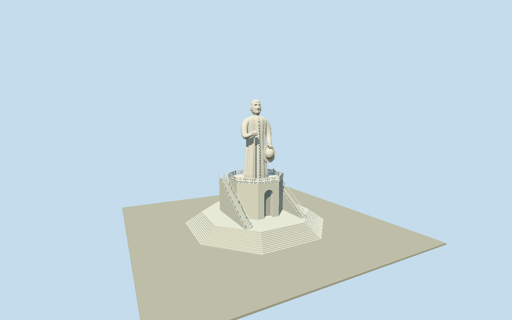

# Statue of Father Cícero, Juazeiro do Norte

Whole standing white concrete FatherCicero sculpture andintrinsicpedestal/access:17mrobedcleric/sculptedhead/combedhair/ears/standingcollar/cassockfolds/centralbuttons, bentrightarm/handrestingoncane andlefthandholdingbroadbrimhat; completeoriginal8vertex10mpedestal/archedfrontrecess/upperbalustrade, intrinsic2.6mnotchedapproach and13original8vertexlowsteprings, twosideflightswithrails andwholeback/sides. Excludeouter61mplazaterrace/hill/nearbychurch/museum/cablecar/trees/people/graffiti/plaquetext/interiors. Notgenericflatstatuecardorhemispherewithfacepaint. Main8vertexwallstarts2.6mandtop10m; intrinsiclowsteppedringsretainoriginalnativecoordinates/heights, no full61mterracefloor. Frontface7hasactualarchedrecess; uppergalleryopenbalustradeandtwosideflights. Modelwhole17mfigurefrom10to27m: fullflowingcassockwithverticalfolds/columnofbuttons/collar, rightelbowforward/handoncaneonviewersleft, lefthandandbroadbrimhatviewersright. Headmusthavephysicalnose/cheekbones/brows/eyeandmouthrecesses/chin/ears/combedhair, notpaintedflatfaceorstockpose; fineportraitbounded. Wholeback/cassock/hatback/armvolume included. Coarsendistancecloth/face/finger/railcountswithoutlosingsilhouette/cane/hat/steppedbase. Freeze400mfieldatfixedfrontapproachbeforegeometry; preserveallrawvalues/tilebytes. Actualhillgroundattachmentunverified.

Authoring state: **review-in-qa.json**. Current completion evidence is in [qa.json](qa.json) and the [completion ledger](../../../../qualla-structures/batches/qualla-002.PROGRESS.md).

- [Statue of Father Cícero](https://qualla.com/statue-of-father-cicero/)

Namedouterterraceway159117399/Q10277578confirmsidentityONLY; its61mwholeplazaslabisexcluded. Intrinsicmainpedestalway378578496hasall8originalvertices/height10m, notchedapproachway378578497all10originalvertices/height2.6m,13native8vertexstepscarry0.2..2.6mheighttags. Main8vertexmeananchor; front+Znormaltooriginalpedestalface7towardnotchedprincipalapproach, +Xparallelthatface. Sculpturefrontbearing/frameandunmappeduppergallery/twosideflightprofilesareoriginalboundedinterpretations, notsurveyedorientation. Municipal27moverall=17mfigure+10mpedestalcontrolsverticalcomposition.

Threeexactalready-publishedKabesaomat/LourencoTorrescreator-PDQuallaoriginals individuallyinspected/nativeSHA1matched/item-specificPD-self/PD-usergrantsbound/existingpolicypasses.18families; unrelatedconflictinghero/Rodin/museumexcluded; MTurmandatorycreditambiguityuninspected/unused. No generatedbitmap/photo texture/downloadedmesh/officialsourcephoto/architecturediagram.

Officialmunicipal27moverall=17mfigure+10mpedestal. Originalcomplete8vertexmainbase/10vertexnotchedapproach/13native8vertex0.2..2.6msteps retained. Whole61mterraceplazaslabexcluded. Nativeheighttagsnotfigurescan; wholewhitecleric/cassockfolds/centralbuttons/collar/physicalhead/ears/brows/nose/eyeandmouthrecesses/combedhair, bentrightforearm/handoncane/lefthandholdinghat areoriginalboundedphotographicsculpturalinterpretations. Fineportrait/hiddenrear/cosmeticsnotphotogrammetry.

Uppergallery/archedfrontrecess/twosideflightprofiles/railcounts/closedpedestalinterior areoriginalboundedestimates. Physicaldetailedfingerseparation/caneclearance/hatbrimandcrown, wholecassockbackandsides included; distantreducedcloth/face/finger/railcounts preservewhole17mfigure/27mheight/cane/hat/base. No antenna/plaquetext/graffiti/people/interiorstairroom.

Independent400m129x129/16641values/2rawTerrariumtiles frozenbeforegeometrywithoutfit/flatten/reacquire. HillDEMnotlocalsurvey; portable/shared/contextflatgroundseparate. Nativepreview/replaceFootprint=false; actualhillgroundattachment/precisestairthresholdsunverified. No outerplaza/hill/church/museum/cablecar/trees/roads/neighbours/whole-sitefloor.

Build: `node packages/worldgen/scripts/generate-authored-places.mjs --ids=statue_of_father_cicero`. Add `--check` to verify exact regeneration. 28208 triangles; 5 materials; no embedded photographs.
