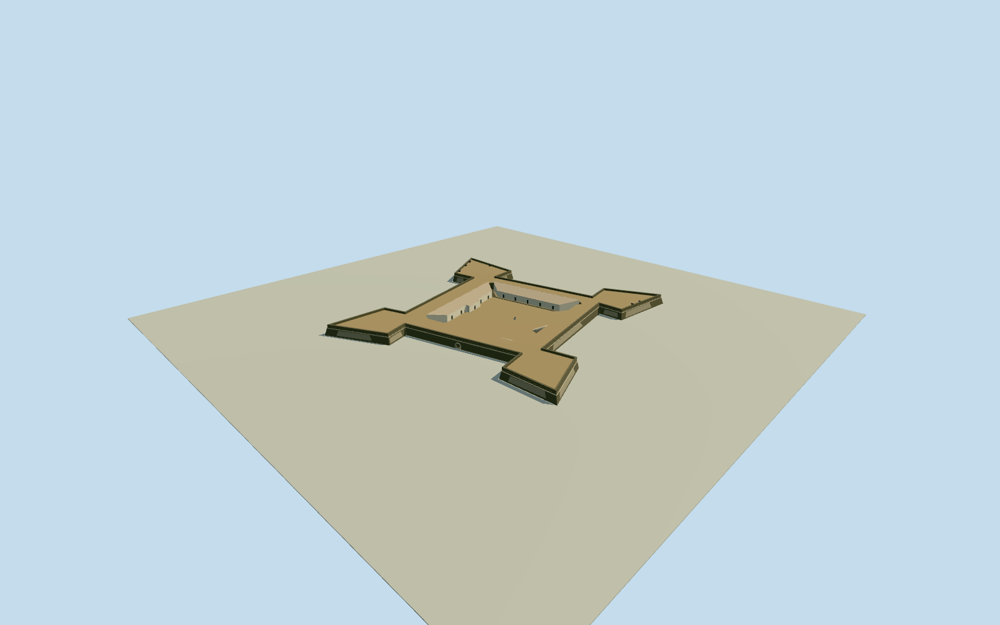

# Fort Orange — Forte de Santa Cruz de Itamaracá

Whole surviving native four-bastion fortress:20outer/10courtyard controls, both8/4controlintrinsic one-storey ranges, battered masonry scarp/roundedcordon/plainparapet, open estimated northentry/barrelvault, courtyard/well/two accessflights and six actual survey-mapped cannon positions. Exact cleared published Qualla closewall original and preserved samephotographerPD-self release; no source pixels embedded. Whole native plan retained; unobserved roof/door/section/contact details are explicit original medium-fi estimates.

Authoring state: **review-in-qa.json**. Current completion evidence is in [qa.json](qa.json) and the [completion ledger](../../../../qualla-structures/batches/qualla-002.PROGRESS.md).

- [Fort Orange (Dutch Brazil)](https://qualla.com/fort-orange-dutch-brazil/)

Actual named historicfort multipolygon8300930/Q1438646;20-control four-bastion exterior321886213/10-control open courtyard588417037, distinct8-control and4-control one-storey intrinsic ranges588417034/588417036. No broad tourist/hotel/beach parcel extrusion.

Whole surviving Portuguese-period Fort Orange / Forte de Santa Cruz de Itamaracá: all four pentagonal bastions and connecting battered masonry curtains, full open native courtyard, both intrinsic one-storey mapped courtyard ranges, continuous cordon/plain parapet, actual six survey-mapped cannon positions, original estimated north entrance passage, well and two rampart access flights. Exact20outer and10inner native perimeter controls plus8/4mapped range controls. Site roads/beach/river/hotel/trees/sign/fence remain context, not fort structure.

Original field frozen first. Original photographic section estimate: courtyardfloor+0.35m over the fixed north approach sample, batteredscarp top4.35m/parapet5.45m/cordon3.65m, batter1m. Intrinsic mapped courtyard range rear5.15m/front3.65m flat-tile single-slope sections. Original northentry placement/curved passage2.6mwide2.8mhigh, well/roof/doors and two24tread rampartflights are bounded unseen estimates. Current DEM is coarse/unclassified and does not certify actual grade/threshold/contact; geographicpreview/replacementfalse. Floor/mainsections set once beforegeometry, never tuned to sourcefield/renders.

Whole native fort footprint and both ranges are retained, with true open courtyard/entry/well and six mapped cannons. Accepted photo is only a close exteriorwall view. Hidden roof form/material, inner doors, well/steps/entrance locations, repairedplaster pattern and cannon orientation are explicit original medium-fi estimates, not photogrammetry or a complete photographic survey. No invented inscriptions/sign art/heraldic relief or unobserved sentry towers. Inner partitions/dungeons/chapel fixtures and movable extra artillery not represented as exterior structures.

Original sourcefield/frame/floor/mainsections frozen before geometry. Source heights are unclassified and include possible fort/canopy signals; exact terrain/entry threshold/contact/current repairs remain unverified. Only physical fort envelope masked, geographicpreview/replacementfalse. Source imagery remains provenance only, no photographicpixels embedded.

Build: `node content/worldgen/source/places/7n/7nx/fort_orange_dutch_brazil/models/generate-fort-orange.mjs`. Add `--check` to verify exact regeneration. 3052 triangles; 6 materials; no embedded photographs.
