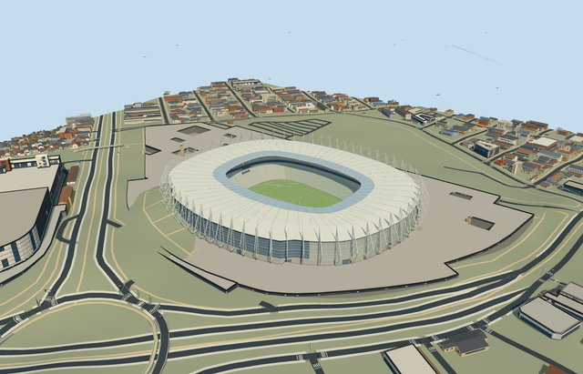

# N0712 — Castelão

Reviewed 2026-10-20 in one continuous author/build/inspect/fix round.

## Appearance

Inspected48 current portable/shared/medium-fi/native-site frames during one ordinary-picture/map/build/inspect/fix pass. Specific native asymmetric oval body and open central aperture, closed pale membrane roof/renderable undersides/darker inner band, repeated exterior tapered triangular lattice fins, curved perforated-metal facade/west glazed hospitality frontage, pale gray-green two-tier bowl/continuous risers/radial aisles/dark central hospitality band, closed neutral football floor/markings/goals, roof-hung neutral boards and recessed closed lower entrances. Corrected roof-rib clearance, lower/upper seating front closure and shared podium replacement edge during construction. Current native views have no earlier red duplicate wall. Portable/synthetic fixtures omit the separate native access podium and expose declared fin attachment planes; the actual native-site fixture supplies that surrounding podium.

## Shared materials and browser levels

Six existing256-square graphs: concrete_plain, metal_painted, metal_perforated_round, glass_frit_triangular, window_grid and fabric_canvas. Concrete supplies structure/floor/risers; paint supplies roof/steel/seats/markings/neutral boards; existing perforated metal supplies the curved screen; existing frit supplies an opaque visual approximation of the translucent roof-edge band; window-grid supplies closed facade/hospitality/entry glazing; canvas grain approximates turf. Physical shared repeats and palette tints, six near material groups, zero embedded images or unique/photo atlases. Each nearby graph is read once; unloading releases model geometry. All six actual GLBs have canonical shared refs and runtime levels use separate POSITION/NORMAL streams with equal counted CPU/GPU geometry bytes. No optical transmission or exact membrane/perforation survey claim.

| Level | Triangles | Bytes | Draws |
| --- | ---: | ---: | ---: |
| skyline | 976 | 99884 | 1 |
| district | 3858 | 378208 | 6 |
| street | 12282 | 1160428 | 6 |
| closeup | 31626 | 3016016 | 6 |

Inspected24 current medium-fi context/mode/silhouette/matched-level/transition frames: street/block/skyline, noon/late afternoon, Economy/High. All four levels retain oval open roof/darker inner band, closed field/two-tier bowl and tall exterior-fin silhouette. District adds facade rhythms/field lines/goals/roof supports; street and closeup add rows/aisles/lattice/portals. Skyline976/district3858/street12282/closeup31626triangles; initial skyline plus district478092bytes, at most six draws. Thin steel is coarsened/removed in distance variants; synthetic context is not geographic evidence. Physical ordinary-laptop/phone and dense-city timing remain pending. Levels976/3858/12282/31626 triangles; at most six draws.

## Approximate map fit

Retained exact-QID OSMrelation8822987 identifies the wider venue, whose509.531x473.022m bounds are not stadium dimensions. Native parent52776565344956 supplies the individual stadium body and142.981965x100.227635m roof aperture. Own anchor[-38.52244534119621,-3.807239025270286]/heading0/native east-south; internal X[.1718245952753119,-.9851275594858137]/Z[.9851275594858137,.1718245952753119] preserves the actual pitch direction.Resident context is checked explicitly:2638 originals,2635 unrelated building inputs unchanged and two native access podium records retained outside their shared stadium edge (5977 wider records). Each podium loses only24.338156981783186m2 inside the same stadium replacement mask; actual loaded podium polygons match original-minus-mask within1.1160465440696044e-7m2 symmetric difference. The owned stadium has zero mathematical remainder and only floating-point numerical residue below1e-7m2 in runtime output; loaded count2638. Original6m terrain samples/native roads/70916.55044416257m2 water unchanged. Bounded opening within90percent body/common floor inset removes coarse DSM intrusion beneath the supported closed floor; outside ground/retained podium holes stay intact. Failure keeps original ground/all2638 buildings; all levels unload with restored ground/water/zero live model geometry. No independent office/parking complex or whole-site slab is authored.

## Limits

Three actually viewed ordinary2013/2014 aerial/interior/facade pictures establish appearance; later alterations are unverified. No qualified dimensions: native roof27m/podium8m/2.8m are unqualified; roof outer27m/inner28.5m/middle rise1.2m, fin apex40.5m, facade8..26m, seating1.1..10.7/14.8..25m and hospitality11.65..14.35m are picture-led allocations.60 close fins, seating rows, lattice/portal inventory and western glazing extent are simplified estimates with20degree/2m fine-facing uncertainty. Raw anchor datum25.401715136644324m/relative floor1.3229952326097845m from lower15percent perimeter fit; coarse mound opening is not a surveyed real excavation/foundation. Fin feet use a declared7.7m podium attachment plane, not independently surveyed grade. Neutral105x68m football layout is representative, not as-built sports certification. Shared frit/perforation/window/turf finishes approximate real materials; roof band is opaque rather than a transmission simulation. No copied live graphics/signage/photo textures, crowd/temporary equipment, furnished hospitality/service rooms, exact dugout/seat inventory or entire parking/underpass/plaza reconstruction. Native access podium and ancillary structures remain runtime context.

## Selected checks

Six Khronos files: zero errors/warnings.1719 actual mesh/material/contact checks; 48 current inspected views. Scene validation/sim30 and strict selected medium-fi audit pass. Source/runtime/LOD hashes and material bindings verified.

Rebuild: node packages/worldgen/scripts/generate-additional-landmarks.mjs --ids=N0712; node packages/worldgen/scripts/import-next-1000-models.mjs --ids=N0712; node packages/tooling/scripts/generate-landmark-lods.mjs --ids=N0712 --force.

Source: sha256:23eff681643aae54adbfac6e54f9f10febe52533497f4f533518bac71d6e04a7

Runtime: sha256:ab4d15a6ded0ebffe0d10c4bdc91623367152683fa28e5dbb3c62189c37d3277

Input: sha256:41c39d542a14bb5a7a47fe22842a3583ff10a725c031062534aa76277847102c

## Viewed ordinary pictures

https://commons.wikimedia.org/wiki/File:Fortaleza_aerea_arenacastelao.jpg — Governo do Brasil; CC-BY-3.0-BR. Viewed only; no pixels copied.

https://commons.wikimedia.org/wiki/File:Castelão_Arena_(4).jpg — Governo Federal Brasileiro / Fábio Lima; CC-BY-SA-3.0. Viewed only; no pixels copied.

https://commons.wikimedia.org/wiki/File:Castelão_Stadium.png — Governo Federal Brasileiro / Fabio Lima; CC-BY-3.0. Viewed only; no pixels copied.
