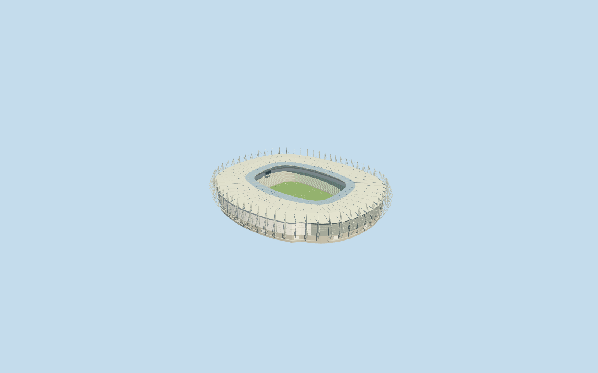

# Castelão

Specific Castelão stadium: native asymmetric oval roof/body and central aperture, closed pale membrane roof with darker translucent inner band and radial undersides, repeated tall tapered exterior lattice fins, curved perforated-metal envelope/west glazed frontage, two pale gray-green seating tiers/continuous risers/radial aisles/dark central hospitality band, closed neutral football floor/markings/goals, supported end boards and recessed closed lower entry groups. Six existing shared concrete/paint/perforated-metal/fritted-glass/window-grid/canvas graphs. Native access podium/holes/ancillary buildings remain independent context. No copied branding/live screen atlas, crowd, furnished hospitality/service interior, whole parking site or bespoke photographic textures.

## Evidence and reconstruction

Published dimensions and reconstructed details are separated in spec.json. Primary references:

- [Reference](https://commons.wikimedia.org/wiki/File:Fortaleza_aerea_arenacastelao.jpg)
- [Reference](https://commons.wikimedia.org/wiki/File:Castelão_Arena_(4).jpg)
- [Reference](https://commons.wikimedia.org/wiki/File:Castelão_Stadium.png)

Specific Castelão stadium: native asymmetric oval roof/body and central aperture, closed pale membrane roof with darker translucent inner band and radial undersides, repeated tall tapered exterior lattice fins, curved perforated-metal envelope/west glazed frontage, two pale gray-green seating tiers/continuous risers/radial aisles/dark central hospitality band, closed neutral football floor/markings/goals, supported end boards and recessed closed lower entry groups. Six existing shared concrete/paint/perforated-metal/fritted-glass/window-grid/canvas graphs. Native access podium/holes/ancillary buildings remain independent context. No copied branding/live screen atlas, crowd, furnished hospitality/service interior, whole parking site or bespoke photographic textures.

## Model and axes

31,626 triangles; 94,878 vertices; 6 material groups; 3,799,040 bytes. Native bounds: -123.707, -1.577, -142.039 to 115.422, 41.913, 141.487. Source hash: `sha256:23eff681643aae54adbfac6e54f9f10febe52533497f4f533518bac71d6e04a7`.

{"x":"east","y":"up","z":"south"}

The geographic proposal uses exact-QID OpenStreetMap evidence. Map-derived orientation and estimated architectural details require real-site visual review; preview eligibility is distinct from geographic/fidelity approval. Map attribution: © OpenStreetMap contributors, ODbL-1.0.

## Reproduce

Run `node packages/worldgen/scripts/generate-additional-landmarks.mjs --ids=N0712` (or add `--check`). The generator preserves manually edited masters by checking their baseline hashes. Import through the standard authored-model workflow with optimization disabled; then capture all QA cameras, including shared-surface views.

## Pending work

- Specific Castelão stadium: native asymmetric oval roof/body and central aperture, closed pale membrane roof with darker translucent inner band and radial undersides, repeated tall tapered exterior lattice fins, curved perforated-metal envelope/west glazed frontage, two pale gray-green seating tiers/continuous risers/radial aisles/dark central hospitality band, closed neutral football floor/markings/goals, supported end boards and recessed closed lower entry groups. Six existing shared concrete/paint/perforated-metal/fritted-glass/window-grid/canvas graphs. Native access podium/holes/ancillary buildings remain independent context. No copied branding/live screen atlas, crowd, furnished hospitality/service interior, whole parking site or bespoke photographic textures.
- Retained exact-QID OSMrelation8822987 identifies the wider venue; its509.531x473.022m axis is not used as stadium dimensions. Standard PMTiles parent52776565344956 supplies the stadium roof/body and central aperture. Own anchor[-38.52244534119621,-3.807239025270286]/global heading0/native east-south, internal X[0.1718245952753119,-0.9851275594858137]/Z[0.9851275594858137,0.1718245952753119] follows minimum rectangle of the142.981965x100.227635m roof aperture. Entire irregular native outer ring retained. Side glazing/entries and fine frame/row distribution are ordinary-picture allocations with20degree/2m uncertainty. The two native access-podium records retain all geometry outside the shared stadium edge; only their overlapping strips within the owned stadium mask are clipped. All other ancillary structures remain intact.
- Native stadium27m and podium8m/2.8m/ancillary tags are unqualified, not surveyed elevations. Working roof outer27m/inner28.5m/middle rise1.2m, fin apex40.5m, facade8..26m, tier1.1..10.7/14.8..25m and hospitality11.65..14.35m are picture-led allocations.60 close-view fins and row/lattice/portal inventory are simplified visual estimates, not a verified structural count. Native podium owns access ramps/whole plaza; model frame bases at7.7m overlap that retained access context.105x68m neutral football field is a representative configuration, not a certified as-built survey. Viewed2013/2014 appearance; later changes unverified.
- Standard6m Mapzen samples contain a strong stadium mound, with peripheral elevations spanning-1.1768092568212616..15.584233367967013m relative to raw anchor datum. Model floor uses the lower15percent perimeter sample (1.3229952326097845m relative), not a surveyed foundation/excavation. A bounded opening inside90percent of the stadium body, clipped inside the common floor of every level with a1percent inset, reveals a closed supported floor; original sample values/outside ground/water remain unchanged. Replace the parent stadium roof shell completely, clipping only overlapping native podium strips inside that same mask. Preserve native podium geometry/holes outside the owned stadium edge, all other independent buildings and native roads. Failure/unload restore original ground. No whole-site flattening/water cutout or inferred real excavation.
- Native stadium27m and podium8m/2.8m/ancillary tags are unqualified, not surveyed elevations. Working roof outer27m/inner28.5m/middle rise1.2m, fin apex40.5m, facade8..26m, tier1.1..10.7/14.8..25m and hospitality11.65..14.35m are picture-led allocations.60 close-view fins and row/lattice/portal inventory are simplified visual estimates, not a verified structural count. Native podium owns access ramps/whole plaza; model frame bases at7.7m overlap that retained access context.105x68m neutral football field is a representative configuration, not a certified as-built survey. Viewed2013/2014 appearance; later changes unverified.

This bundle follows the medium-fi standard. Medium-fi appearance and geographic fit are reviewed separately. Hash-bound visual acceptance is recorded separately after capture inspection.
