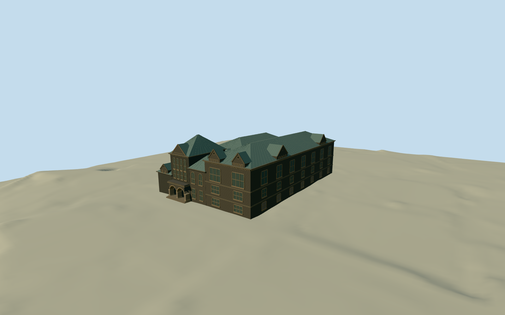

# Bishop Museum Main Building

Basalt museum with deep copper roofs, Hawaiian Hall’s stone dormers and a double-arched entrance tower.

Authoring state: **review-in-qa.json**. Current completion evidence is in [qa.json](qa.json) and the [completion ledger](../../../../qualla-structures/batches/qualla-004.PROGRESS.md).

- [Bishop Museum](https://qualla.com/bishop-museum/)

The model represents the connected main exhibition halls and the formal entrance. Roof and floor heights are estimated from the historic exterior documentation and the native plan.

The campus’s detached buildings, modern courtyard additions, exhibit interiors and fine entrance ornament are outside scope.

Build: `node content/worldgen/source/places/87/87z/bishop_museum_main_building/models/generate-bishop-museum-main-building.mjs`. Add `--check` to verify exact regeneration. 13162 triangles; 5 materials; no embedded photographs.
