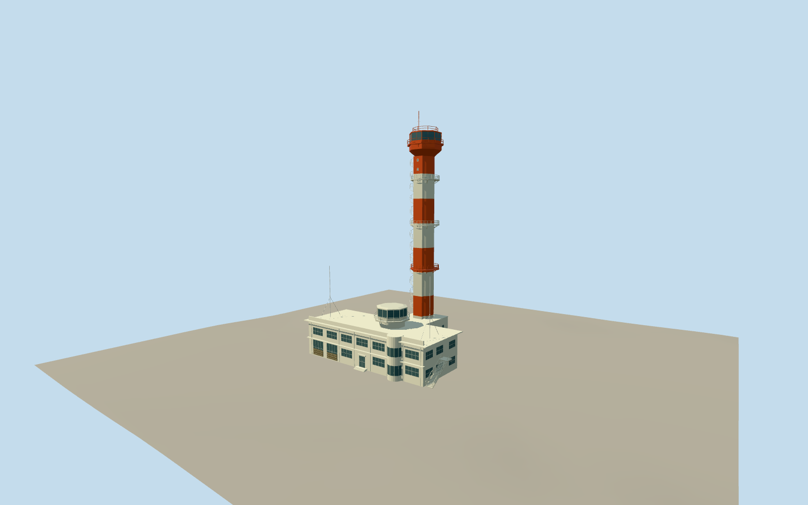

# Ford Island control tower

Restored orange-and-white control/water tower, three intermediate circular balconies, elevator spine, spiral escape stair and upper octagonal glazed cab; attached cream Moderne operations building with garage bays, rounded bay and smaller aerological cab.

Authoring state: **review-in-qa.json**. Current completion evidence is in [qa.json](qa.json) and the [local 100 ledger](../../../../qualla-structures/batches/PROGRESS.md).

- [Pearl Harbor Aviation Museum](https://qualla.com/pearl-harbor-aviation-museum/)

Original medium-fi restored exterior, using inspected local Qualla aerial for site context and museum/Warren LeMay supplemental front and side photographs for architectural evidence; not a measured survey.

Museum sources describe 158 ft tower height and 168 ft observation access differently. The recipe approximates a 48.2 m shaft/tank transition and 51.2 m upper deck; individual levels, cabin roof and antenna heights are estimates.

Orange/white restored exterior represents the modern tower, not the incomplete camouflage-era 1941 structure. Spiral tread count, hidden rear windows, rail subdivisions, doors and rooftop equipment are simplified.

Includes the attached operations building and small aerological cab. Hangars, museum aircraft, interiors, vegetation and other site structures are excluded.

Reference photographs are viewed for research and are not embedded or redistributed. Generalized map geometry and host terrain require review when using another elevation dataset.

Build: `node packages/worldgen/scripts/generate-authored-places.mjs --ids=ford_island_control_tower`. Add `--check` to verify exact regeneration. 16666 triangles; 3 materials; no embedded photographs.
