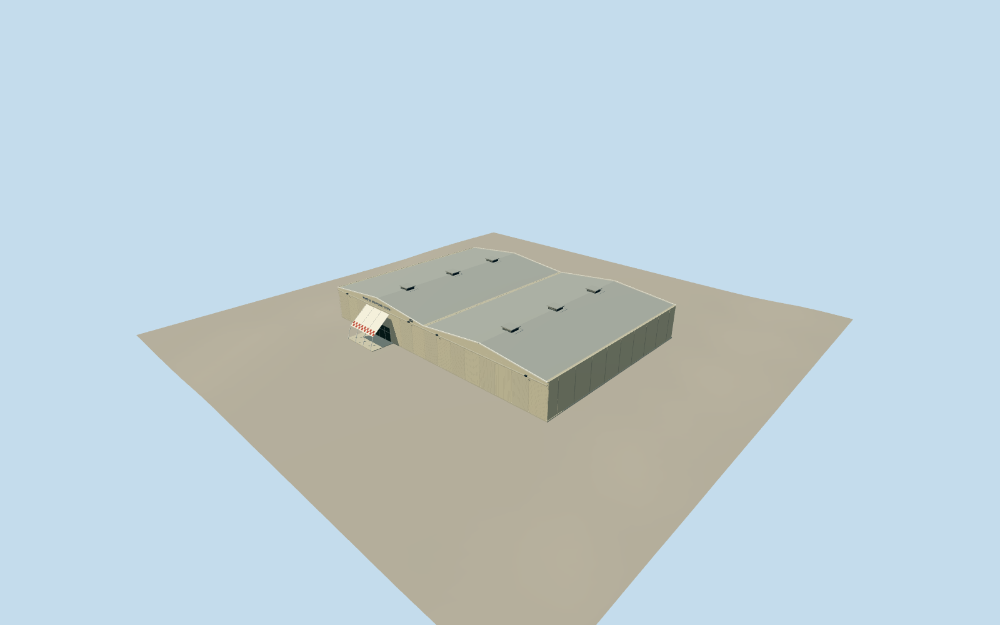

# Pearl Harbor Aviation Museum — Hangar 37

Historic twin shallow-gable hangar with cream corrugated sliding doors, ridge vents and the white entrance canopy with red checker rows, following dated museum references.

Authoring state: **review-in-qa.json**. Current completion evidence is in [qa.json](qa.json) and the [local 100 ledger](../../../../qualla-structures/batches/PROGRESS.md).

- [Pearl Harbor Aviation Museum](https://qualla.com/pearl-harbor-aviation-museum/)

Original medium-fi exterior from a local Qualla aerial plus individually inspected museum and architect front photographs; no survey accuracy claimed.

Mapped approximately 68.7 by 47.7 m footprint and northeast entrance are retained. Architect project floor area is not assumed to equal the mapped footprint.

Twin shallow gables, cream metal cladding, door tracks, checker canopy and ridge vents follow dated references. Exact heights, rear service door, roof equipment placement and concealed side details are interpretations.

Dated 2008–2017 exterior and Pacific Aviation Museum lettering are represented; later name/signage or renovation changes are not fully documented.

Aircraft, exhibits, interiors, landscape, antennas outside the footprint, Hangars 79/54 and the separate control tower are excluded. Reference pixels are not redistributed.

Independent terrain is preserved; contact with other host DEMs remains uncertain.

Build: `node packages/worldgen/scripts/generate-authored-places.mjs --ids=hangar_37`. Add `--check` to verify exact regeneration. 2318 triangles; 5 materials; no embedded photographs.
