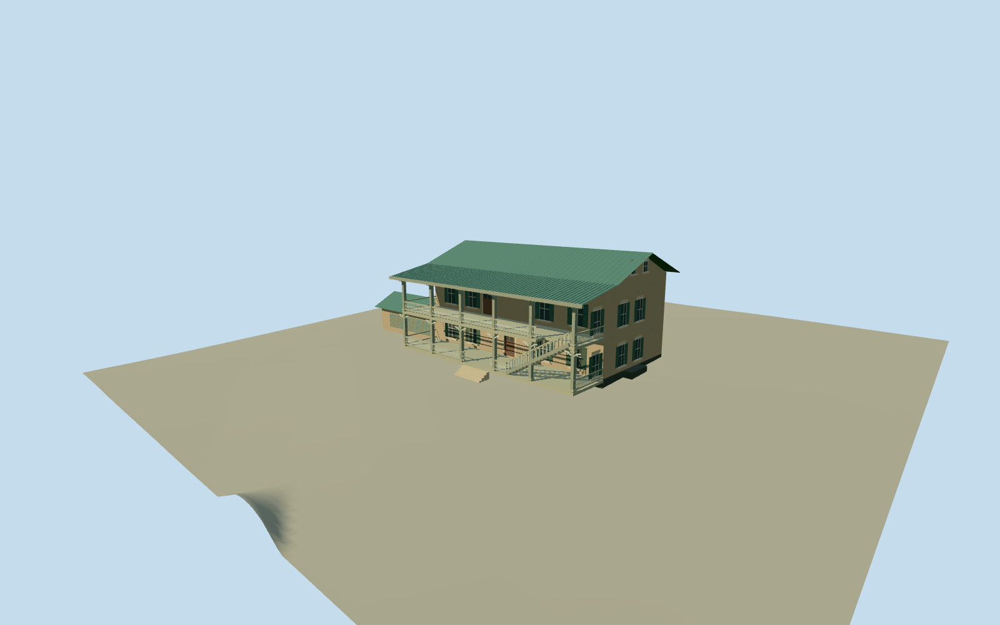

# Huliheʻe Palace

The restored Huliheʻe Palace in Kailua-Kona, with its green roof and two-storey waterfront lanai.

Authoring state: **review-in-qa.json**. Current completion evidence is in [qa.json](qa.json) and the [completion ledger](../../../../qualla-structures/batches/qualla-004.PROGRESS.md).

- [Huliheʻe Palace](https://qualla.com/hulihe-e-palace/)

The original views establish the bayside lanai and side trim. Fine bracket shapes and details of the less visible landward entrance use architectural estimates.

The unchanged original relief is cropped to the palace grounds. The wider coastal DEM contains extreme values offshore.

Build: `node content/worldgen/source/places/8e/8e3/hulihe_e_palace/models/generate-hulihe-e-palace.mjs`. Add `--check` to verify exact regeneration. 7024 triangles; 6 materials; no embedded photographs.
