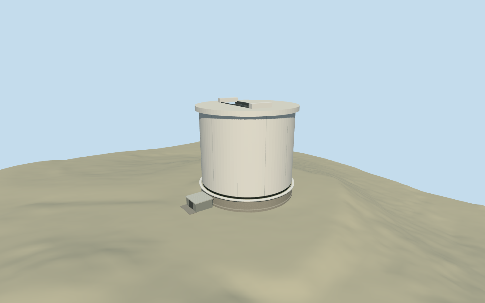

# James Clerk Maxwell Telescope

The white rotating observatory on Maunakea, with its dark bearing ring, recessed shutter and north entrance.

Authoring state: **review-in-qa.json**. Current completion evidence is in [qa.json](qa.json) and the [completion ledger](../../../../qualla-structures/batches/qualla-004.PROGRESS.md).

- [James Clerk Maxwell Telescope](https://qualla.com/james-clerk-maxwell-telescope/)

The capture represents one closed position of the revolving shell. Roof shutter bearings, maintenance features and small openings are interpreted from the exterior reference.

The 15-metre reflector and its mechanisms remain inside the exterior shell. Adjacent observatories are outside this entry.

Build: `node content/worldgen/source/places/8e/8e9/james_clerk_maxwell_telescope/models/generate-james-clerk-maxwell-telescope.mjs`. Add `--check` to verify exact regeneration. 2618 triangles; 5 materials; no embedded photographs.
