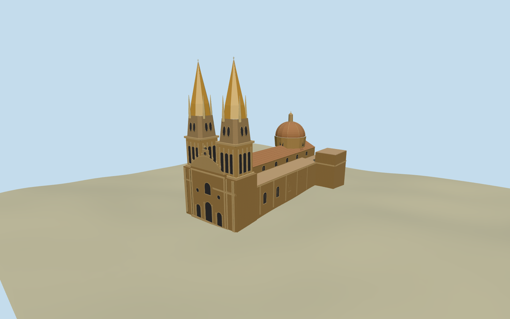

# Guadalajara Cathedral

Guadalajara’s cathedral with its measured twin spires, segmented plaza-facing stone front, and eastern basilica roof.

Authoring state: **review-in-qa.json**. Current completion evidence is in [qa.json](qa.json) and the [completion ledger](../../../../qualla-structures/batches/qualla-004.PROGRESS.md).

- [Guadalajara Cathedral](https://qualla.com/guadalajara-cathedral/)

The surviving cathedral and its measured tower heights are represented. The separately named Sagrario, city plaza furniture and cathedral interiors are outside this model’s scope.

The mapped 76 metre long cathedral envelope controls the local model. Published larger dimensions encompass the wider architectural site. The exact side aisle segmentation, stone ornament, roof levels and lantern detail are approximated.

Landings are tied to the preserved source terrain. Older plaza grading and the demolished atrium are outside the represented era.

Build: `node content/worldgen/source/places/9e/9ew/guadalajara_cathedral/models/generate-guadalajara-cathedral.mjs`. Add `--check` to verify exact regeneration. 11755 triangles; 4 materials; no embedded photographs.
