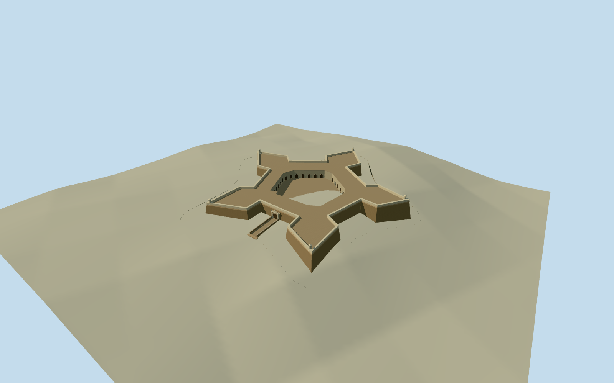

# Fort of San Diego

Standing Acapulco coastal fortress with five stone points, dry moat, an open museum court and a masonry approach to its neoclassical gate.

Authoring state: **review-in-qa.json**. Current completion evidence is in [qa.json](qa.json) and the [completion ledger](../../../../qualla-structures/batches/qualla-004.PROGRESS.md).

- [Fort of San Diego: Acapulco's Star-Shaped Guardian](https://qualla.com/fort-of-san-diego/)

Draft exterior: approximate photographic proportions and simplified ornament. It is not a survey, photogrammetric reconstruction or approved current geographic replacement.

Original eighteenth-century replacement fort scheme and Ramón Panón’s dated masonry sections, reproduced by INEGI and checked against the INAH reconstruction account.

Terrain sampling/contact, geographic alignment and site activation remain pending. Runtime LODs are produced by the registered after-import pipeline and require visual review.

Reference photos remain in the local Qualla corpus; only provenance, paths and hashes are retained here.

Build: `node content/worldgen/source/places/9f/9fb/fort_of_san_diego/models/generate-fort-of-san-diego.mjs`. Add `--check` to verify exact regeneration. 4862 triangles; 8 materials; no embedded photographs.
