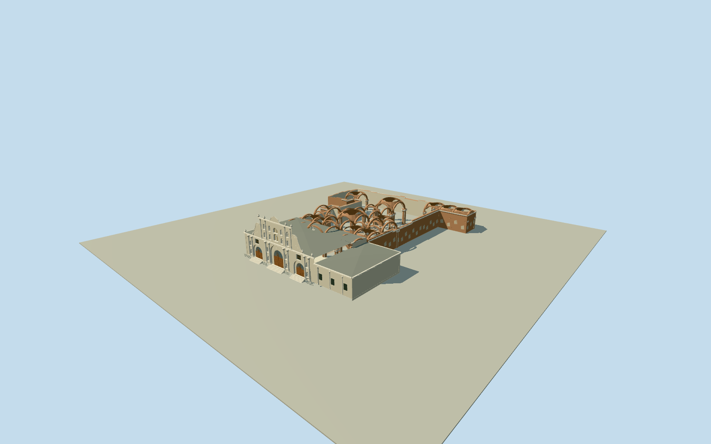

# Antigua Guatemala Cathedral

Complete native surviving cathedral: cream west Baroque facade/parish with3recessed timber doors/blue radial fanlights, paired engaged columns, lower and upper saint niches, scroll shoulders/raised ornament, urns and central crown; separate lower southern parish wing/roofs. Full eastern roofless ruin extent with battered brick/plaster walls, articulated compound piers/capitals, real open transverse/lateral arches and thin broken vault-edge fragments around the20mapped roof voids. Bounded intrinsic nave floor/entrance steps/iron fence only. Lost bell towers and complete old dome/roof absent. Native perimeters/voids exact, structural sections/elevations/hidden details photo-estimated.

Authoring state: **review-in-qa.json**. Current completion evidence is in [qa.json](qa.json) and the [completion ledger](../../../../qualla-structures/batches/qualla-002.PROGRESS.md).

- [Antigua Guatemala Cathedral](https://qualla.com/antigua-guatemala-cathedral/)

Original named cathedralrelation7212555/CatedraldeSanJose/Q2942367supplies the complete50-vertex perimeter and20inner roof-void rings. Original named ruined-cathedralrelation18928711supplies its59-vertex surviving-ruin extent. Exact shared-node boundary difference leaves a35-vertex western/southern standing-parish remainder. These are site/roof-surface controls, not measured ground-level pier/door plans or heights. In particular the20holes are mapped open-to-sky vault/roof voids, not20courtyards and not20standing domes to rebuild. Perimeter and voids are retained; arches/piers/vault fragments, facades and elevations are photographic medium-fi interpretations.

Current standing west/south parish and complete eastern ruined extent are both included. Original50vertex perimeter/59vertex ruin boundary and20roof voids are retained; exact35vertex standing remainder is their shared-native-boundary difference. Western main Baroque composition spans the original roughly40.6mfront; the lower parish wing continues south within the original outline. No adjacent ArchbishopPalace/SacristanHouse/seminary, lost bell towers or complete old dome is inferred.

Main cornice10.2m/crown21.1m, lower parish8.4m/hidden hipped roofs, ruined walls9–10m and surviving arches/vault fragments roughly8–13m are photo-based medium-fi estimates, not surveys. Native voids locate open roof areas rather than measured ground-level pier sections; supporting pier/arch spans/levels and partial vault thickness/breakage are conservative original interpretations. No solid honeycomb extrusion or whole ruin roof replaces the open nave.

One exact published QuallaNerdoguateCC0portal original and3explicitly self-dedicatedCC0front/nave originals from the same creator were fully inspected. Native metadata dates2025-01-03despite2024filenames. Interior event/carpet scenes, incomplete-attribution night source, other churches and archival appearances were not used. No photographic texture, modern ticket booth/furnishings, inscriptions, park/trees, visitors/vehicles or streets.

Facade saints use statically baked public Molen figure anatomy under original long robes/attributes; detailed individual identities, portraits, gilded lettering, exact floral carving/capitals and fine erosion are bounded medium-fi approximations. Scrolls, doors/fanlights, niches, moldings, urns, compound piers and visible open arches are real geometry; delicate relief, louvres/fence rods and vault fragments retire with distance.

The fixed west/front approach[0,53]controls approximate datum, with bounded intrinsic front steps and nave floors near.85m. Footing extends.25m below datum. Exact thresholds, original grade/drainage, demolished foundations and contact with host terrain remain unverified; source relief is preserved without a whole-site platform.

Build: `node packages/worldgen/scripts/generate-authored-places.mjs --ids=antigua_guatemala_cathedral`. Add `--check` to verify exact regeneration. 57240 triangles; 6 materials; no embedded photographs.
