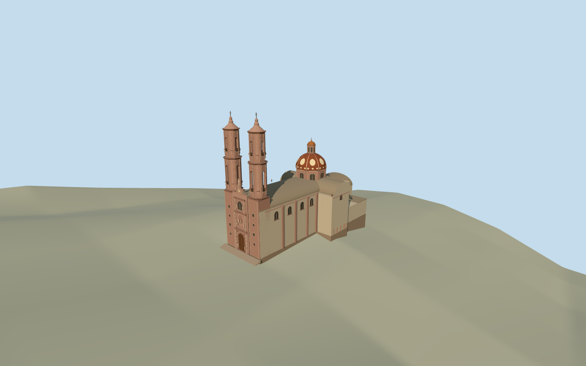

# Church of Santa Prisca de Taxco

Santa Prisca’s twin open Baroque belfries, carved pink-stone portal and patterned crossing dome above Taxco’s hill town.

Authoring state: **review-in-qa.json**. Current completion evidence is in [qa.json](qa.json) and the [completion ledger](../../../../qualla-structures/batches/qualla-004.PROGRESS.md).

- [Church of Santa Prisca de Taxco](https://qualla.com/church-of-santa-prisca-de-taxco/)

Draft exterior: approximate photographic proportions and simplified ornament. It is not a survey, photogrammetric reconstruction or approved current geographic replacement.

J. Chanfreau measured the tower-cross tips at 44.40 m above the plaza and the facade statue crown at 25.30 m. The barrel vault, south elevation and drum are proportioned using Peabody’s plates and the federal architectural survey.

Terrain sampling/contact, geographic alignment and site activation remain pending. Runtime LODs are produced by the registered after-import pipeline and require visual review.

Reference photos remain in the local Qualla corpus; only provenance, paths and hashes are retained here.

Build: `node content/worldgen/source/places/9g/9g3/church_of_santa_prisca_de_taxco/models/generate-church-of-santa-prisca-de-taxco.mjs`. Add `--check` to verify exact regeneration. 16103 triangles; 8 materials; no embedded photographs.
