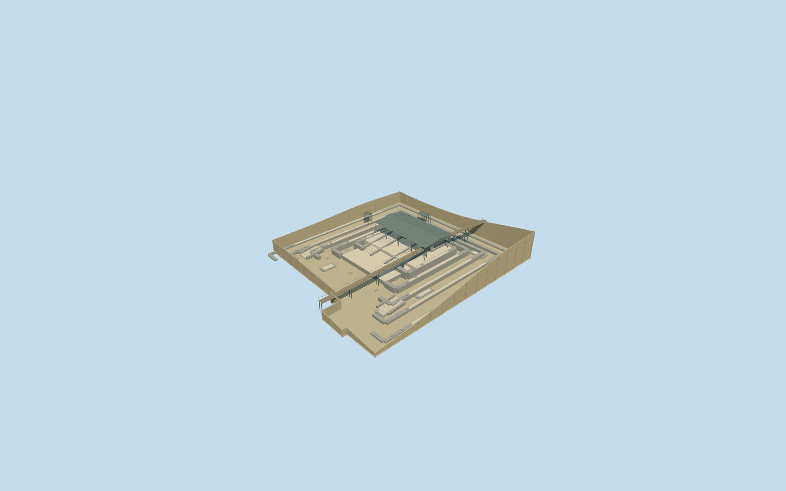

# N0512 — Templo Mayor

Reviewed 2026-10-19. Accepted for medium-fi surviving exterior and approximate standard-map fit. Built, inspected, corrected and completed in one continuous round.

## Architecture

Inspected the current portable, shared-material, medium-fi and actual-site renders in one continuous authoring round. Surviving main-pyramid excavation: low interrupted construction-stage bands, broad exposed floors, west-facing stair flights, paired older shrine bases beneath the mapped protective canopy, two small covers, low rubble/plaster traces and a supported pedestrian crossing. Corrected unsupported lower stairs with a seated approach terrace/foundations and replaced a floor texture that read as wood. No tall intact 1521 pyramid or twin temple towers are reconstructed.

## Shared materials

Five reused 256² graphs: dry volcanic-stone masonry, lime plaster, plain concrete for the simplified exposed floor/retaining boundary, plain timber for the crossing and standing-seam metal for the modern covers/supports. Metric UVs, linear neutral tints, no embedded images or unique atlases. Each graph loads once. Portable and flat material stages show an isolated cutaway; their flat ground is not evidence of the native excavation grade. The actual-site fixture supplies the retained native terrain for contact review.

## Browser levels

| Level | Triangles | Bytes | Draws |
| --- | ---: | ---: | ---: |
| skyline | 988 | 102008 | 1 |
| district | 3436 | 315092 | 5 |
| street | 4612 | 418700 | 5 |
| closeup | 4612 | 418700 | 5 |

All 25 required views inspected: noon/late, Economy/High, street/block/skyline, untextured silhouette, four details, all four authored levels and transitions. Levels 988 / 3,436 / 4,612 / 4,612 triangles, at most five model draws; initial geometry 417,100 bytes. Street and close-up share the same current geometry because it already fits the street budget. Separate GPU streams avoid repeated attribute uploads. The skyline preserves the closed pit floor, stage bands, paired shrine masses and covers; thin canopy posts and smaller stair/altar details resolve nearer. Physical-device and dense-city timings remain pending.

## Geographic fit

The main layer−1 polygon and three protective-cover polygons retain their original vertices. Named points put Tláloc to the north and Huitzilopochtli to the south. Model+X east,+Z south at heading 0; internal architectural−X faces west, with an approximately 5.85-degree east/south construction axis. Internal wall stages, depths and breaks are photo-led visualization estimates. Reviewed approximate excavation fit on the unchanged standard Mapzen grid. A bounded opening follows the mapped layer−1 main-pyramid polygon. Its entire 5,759.29m² pocket is sealed by an authored opaque floor at every LOD; retaining sides overlap the native boundary. Stair foundations and the approach terrace are seated to that floor. Four temple map components are replaced; all 990 independent in-tile buildings, native water and the pedestrian alignment remain unchanged. Exact excavation depths and archaeological phase profiles are visualization estimates. The initially clipped 10m resident test exposed a temporary sky gap. The renderer now keeps ground-opening geometry and its opening whole in every intersecting resident tile. The current single-tile view shows the complete excavation and nine actual renderer rays find its floor; two-owner regression tests prove shared geometry and restoration after the final release.

## Scope and limits

Accepted as medium-fi surviving main-pyramid exterior and approximate standard-map fit. Exact construction-phase attribution, wall/step inventories, damage, paint, carved narratives, artifacts, canopy joinery and excavation depths are not surveyed. The −6.3m floor is a conservative visualization datum derived from coarse standard terrain, not an archaeological measurement. Casa de las Águilas, the museum and cathedral remain independent context. The mapped pedestrian alignment is retained with an approximate supported crossing; it is not a surveyed reconstruction of present visitor routing. No navigable interior or intact ancient temple is claimed. Whole ground-opening instances share geometry/textures but can add draws when more than one intersecting tile is resident.

## Checks

Two registered recipes rebuild the 556,836-byte master. Six Khronos files: zero errors/warnings. 8,556 floor-coverage probes pass. Inspected 53 current views: 9 portable, 9 shared, 25 medium-fi and 10 actual-site/fallback/partial-tile. Scene validation and sim 30 pass. Native outside terrain, 965.25m² of mapped water and all 990 independent in-tile buildings are unchanged. A bounded ground opening is active only with the model; failed loading restores all 994 native map records and original terrain, and eviction frees geometry. The ground-opening renderer fix passes its package build, typecheck, lint and 71 related tests. Full repository CI stopped at assets:check because the installed bundle predates this model batch; downstream packed/docs/golden gates were not reached. Broad reproducibility, asset lock refresh and release verification remain batch work.

Rebuild: node packages/worldgen/scripts/generate-additional-landmarks.mjs --ids=N0512; node packages/worldgen/scripts/import-next-1000-models.mjs --ids=N0512; node packages/tooling/scripts/generate-landmark-lods.mjs --ids=N0512 --force.

Source: sha256:7a188a71dd1c008bccfcfeb5598719b348cdaf30ac80b4abe8eff6dd5ad9af95

Runtime: sha256:d67f99f6e77fd354e41a455697478529fe6e93ae7cd7875e75c6725b4b94beee

Input: sha256:9ff2f92fd5c1fbca5b7f434e72cb2769bf9422f4e4bd1eb2129afc685e65f3b2

## Ordinary pictures

https://commons.wikimedia.org/wiki/File:Ruinas_del_Templo_Mayor_-_Centro_Hist%C3%B3rico_de_Ciudad_de_M%C3%A9xico.jpg — Juan Carlos Fonseca Mata; 2020-11-14; CC BY-SA4.0; viewed only. No pixels copied.

https://commons.wikimedia.org/wiki/File:TemploMayorCathedralMexicoCity.JPG — Thelmadatter; 2008-03-23; Public domain; viewed only. No pixels copied.
