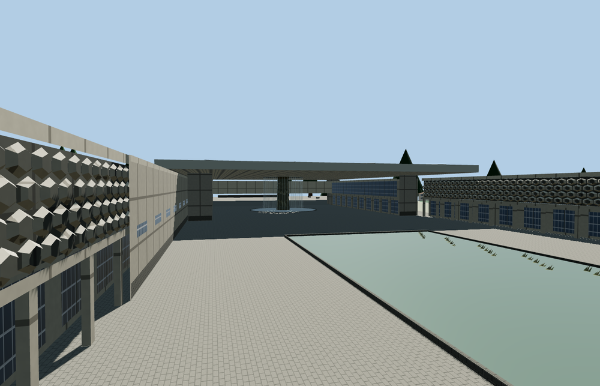

# National Museum of Anthropology

The National Museum of Anthropology in Mexico City, with the limestone entrance and civic relief, recessed lower gallery walks, folded upper screens, reflecting pool and El Paraguas canopy with its carved central column and falling water.

The 21,296-triangle source rebuilds byte for byte. Skyline, district, street and close-up use 922, 2,898, 7,760, 21,076 triangles. The first two tiers total 381,204 bytes. Six GLBs validated and 38 current views were inspected.

All four tiers retain the roof aperture, both basins and the clear walk underneath the canopy. The viewer preserves 4 independent buildings, 120 transport records and sampled water outside the cut. Failed loading restores the mapped museum and both basin surfaces.

The gallery, entrance, canopy and pools use their mapped outlines. Visible roof details, lattice modules, the carved bronze relief and plaza fittings are medium-fi interpretations of ordinary photographs. The localized grade cut compensates for coarse viewer terrain across the pedestrian court. The water curtain is static geometry. Underground circulation and museum exhibits are outside the exterior scope. Physical-device timings are unmeasured.

Rebuild with `node packages/worldgen/scripts/generate-national-museum-of-anthropology.mjs`. Append `--check` to compare exact bytes. Use `--ids=national_museum_of_anthropology` for targeted import, LOD, placement and readiness.
