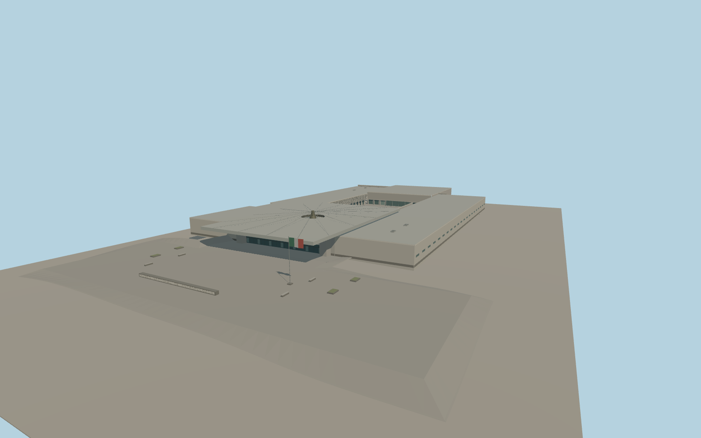

# National Museum of Anthropology

The National Museum of Anthropology in Mexico City, with the limestone entrance and civic relief, recessed lower gallery walks, folded upper screens, reflecting pool and El Paraguas canopy with its carved central column and falling water.

Run `node packages/worldgen/scripts/generate-national-museum-of-anthropology.mjs` to rebuild the source master. Append `--check` to compare the exact bytes. Use `--ids=national_museum_of_anthropology` for targeted import, LOD generation and placement.

The gallery, entrance, canopy and pools use their mapped outlines. Visible roof details, lattice modules, the carved bronze relief and plaza fittings are medium-fi interpretations of ordinary photographs.

The localized grade cut compensates for coarse viewer terrain across the pedestrian court. The water curtain is static geometry. Underground circulation and museum exhibits are outside the exterior scope.

Original geometry follows the repository license. Map data is © OpenStreetMap contributors under ODbL-1.0 via Protomaps. Terrain samples are described in terrain-grid.json. Ordinary pictures stay local and are not redistributed or used as textures. Current acceptance is recorded in qa.json.
