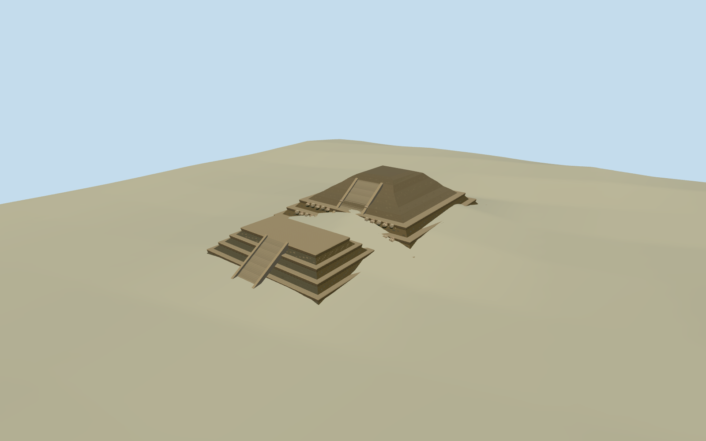

# Temple of the Feathered Serpent, Teotihuacan

Teotihuacan’s excavated pyramid with a relief-covered western façade and the adjoining four-tier Plataforma Adosada.

Authoring state: **review-in-qa.json**. Current completion evidence is in [qa.json](qa.json) and the [completion ledger](../../../../qualla-structures/batches/qualla-004.PROGRESS.md).

- [Temple of the Feathered Serpent, Teotihuacan](https://qualla.com/temple-of-the-feathered-serpent-teotihuacan/)

Draft exterior: approximate photographic proportions and simplified ornament. It is not a survey, photogrammetric reconstruction or approved current geographic replacement.

Contemporary excavator measurements fix the main square base and surviving rubble height. The archival west elevation shows the three well-preserved carved courses and the stair. INAH documents four plain levels on the adjoining western platform.

Terrain sampling/contact, geographic alignment and site activation remain pending. Runtime LODs are produced by the registered after-import pipeline and require visual review.

Reference photos remain in the local Qualla corpus; only provenance, paths and hashes are retained here.

Build: `node content/worldgen/source/places/9g/9g3/temple_of_the_feathered_serpent_teotihuacan/models/generate-temple-of-the-feathered-serpent-teotihuacan.mjs`. Add `--check` to verify exact regeneration. 9964 triangles; 4 materials; no embedded photographs.
