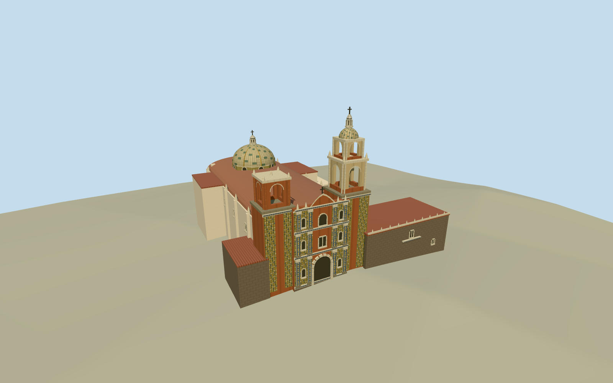

# Church of San Francisco Acatepec

San Francisco Acatepec with its tiled Baroque facade, asymmetrical towers, red vault and glazed dome.

Authoring state: **review-in-qa.json**. Current completion evidence is in [qa.json](qa.json) and the [completion ledger](../../../../qualla-structures/batches/qualla-004.PROGRESS.md).

- [Church of San Francisco Acatepec](https://qualla.com/church-of-san-francisco-acatepec/)

Draft exterior: approximate photographic proportions and simplified ornament. It is not a survey, photogrammetric reconstruction or approved current geographic replacement.

The cleared original clips and stills document the unequal towers, tiled facade, red vaulted roofs, white nave exterior, glazed dome and courtyard gallery.

Terrain sampling/contact, geographic alignment and site activation remain pending. Runtime LODs are produced by the registered after-import pipeline and require visual review.

Reference photos remain in the local Qualla corpus; only provenance, paths and hashes are retained here.

Build: `node content/worldgen/source/places/9g/9g6/church_of_san_francisco_acatepec/models/generate-church-of-san-francisco-acatepec.mjs`. Add `--check` to verify exact regeneration. 12806 triangles; 8 materials; no embedded photographs.
