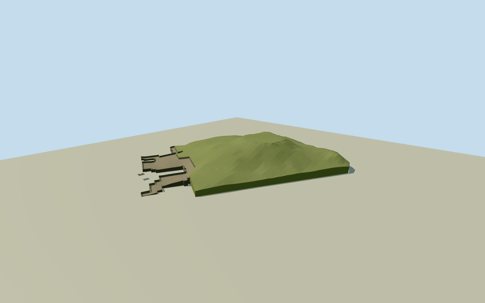

# Great Pyramid of Cholula

Complete surviving earth-covered Cholula pyramid from original independent relief/native30control mound and connected45control southern excavation, native10control western exposed ruin and four-control court platform/low stucco altar. Three real stair flights/exposed masonry wall courses; actual full asymmetric covered volume, no generic cone/fully uncovered speculative pyramid or broad archaeological-parcel extrusion. Exact cleared published2004AltevirVechiaPD terrace/altar images; whole macro shape from frozen source elevations with explicit pregeometry summit/excavation interpretations. Independent church/museum/RedBuilding excluded.

Authoring state: **review-in-qa.json**. Current completion evidence is in [qa.json](qa.json) and the [completion ledger](../../../../qualla-structures/batches/qualla-002.PROGRESS.md).

- [Great Pyramid of Cholula](https://qualla.com/great-pyramid-of-cholula/)

Specific native30-control pyramid main-mass extent and connected45-control southern ruin/terrace assembly. These are archaeological structure extents, not measured vertical wall polygons. Whole covered mass must follow original independent relief; no broad zone parcel/flat box extrusion.

Whole present earth-covered GreatPyramid main mass (actual30-control named Q1417475 mound extent/way157402817) and physically connected southern exposed terrace/altar court (actual45-control ruin assembly466134806), retaining all connected visible earth-and-masonry structure. Shape of the whole covered volume from independently frozen original elevation samples within native structure controls; cleared published photographs guide exposed masonry/altar only. No idealized fully uncovered pyramid, broad archaeological-zone parcel extrusion, detached RedBuilding/museum/visitor infrastructure or independently identified summit churchQ5991792/way466164933.

Full artificial covered pyramid from original independent relief/native extents. Crown plateau is an explicit pregeometry bare-mound estimate: median of16unchanged source samples on40mring surrounding independent church; source maximum includes that building and is not blindly represented as grass roof.3.6m southern and1.8m western exposed-section depths/three talud bands/three10-tread stairs/low altar frieze are bounded photo-derived original geometry sections, not measured archaeological surveys. Source heights preserved; no source field/floor/mainsections fitting after geometry. Host contact unverified, preview/replacement false.

Covered mass follows original composite-relief flank samples/native structure boundaries; unclassified source includes vegetation/built contributions. Crown plateau from fixed40m source-ring median is a bounded pregeometry interpretation excluding independently identified church height. Nominal66m historical monument height is not asserted as a surveyed present bare-mound dimension. No source grid/heightmap/rawtile/frame/floor/mainsection fitting or late raising.

Thirty-mound/45southern/10western/four-platform native control occurrences retained, including shared controls. Exposed excavation depths, stair placement/counts/talud courses, altar/frieze dimensions/fine glyph and restoration colors are original bounded estimates from two exact published2004PD detail photographs and primary technical facts. No unverified whole-view image/historical drawing, image pixels/volcano/trees/museum/RedBuilding or independent church geometry.

Buried artificial/natural core and edge skirts are exposed by isolated flat fixtures. Native footprint-owned excavation/volume opening preserves all original source elevations. Exact classified terrain/archaeological section/threshold/foundation contact and current fine repairs unverified; geographic preview/replacement false.

Build: `node content/worldgen/source/places/9g/9g6/great_pyramid_of_cholula/models/generate-great-pyramid-of-cholula.mjs`. Add `--check` to verify exact regeneration. 9625 triangles; 4 materials; no embedded photographs.
