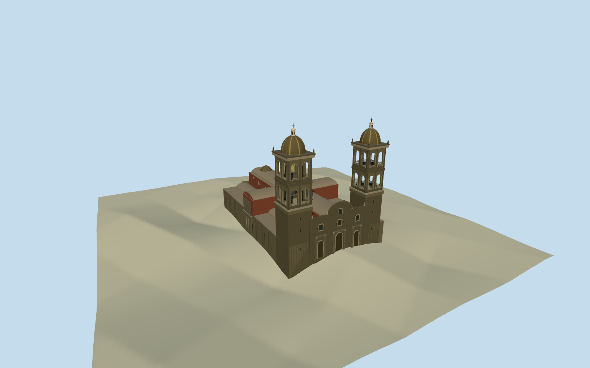

# Puebla Cathedral

Puebla Cathedral’s dark stone facade, paired two-stage bell towers, raised cross vault and glazed crossing dome.

Authoring state: **review-in-qa.json**. Current completion evidence is in [qa.json](qa.json) and the [completion ledger](../../../../qualla-structures/batches/qualla-004.PROGRESS.md).

- [Puebla Cathedral](https://qualla.com/puebla-cathedral/)

Draft exterior: approximate photographic proportions and simplified ornament. It is not a survey, photogrammetric reconstruction or approved current geographic replacement.

The Qualla drone views establish open stacked arched belfries, the triple dark stone facade, gray-brown vaulted roof, brick-red crossing drum, and gold and green glazed dome. Heritage documentation gives the approximate tower height.

Terrain sampling/contact, geographic alignment and site activation remain pending. Runtime LODs are produced by the registered after-import pipeline and require visual review.

Reference photos remain in the local Qualla corpus; only provenance, paths and hashes are retained here.

Build: `node content/worldgen/source/places/9g/9g6/puebla_cathedral/models/generate-puebla-cathedral.mjs`. Add `--check` to verify exact regeneration. 15058 triangles; 6 materials; no embedded photographs.
