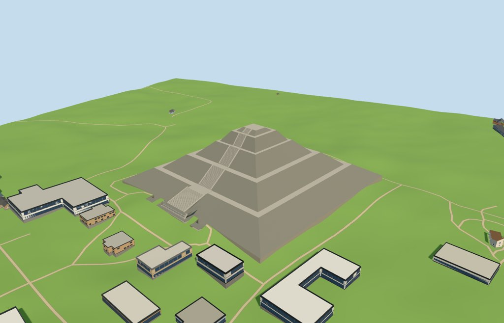

# N0493 — Pyramid of the Sun

Reviewed 2026-10-18. Accepted for the specific medium-fi exterior and approximate full-site placement.

## Exterior and materials

Five mapped sloping stages, horizontal terraces, a flat summit without an invented temple, west-facing stair flights and landings, and projecting lower platforms. The principal footprint and 24 constituent terrace/platform records establish the plan and orientation. Stair counts, width transitions, cheek heights, regularized terraces and the small summit inset remain approximate.

Two common 256-square volcanic masonry/grain graphs use metric UVs and linear neutral-grey tints. Three nearby material draws; no embedded images or unique atlas. Every graph loads once, and eviction frees all model geometry. Master: 2,216 triangles / 268,388 bytes.

## Browser levels

| Level | Triangles | Bytes | Draws |
| --- | ---: | ---: | ---: |
| skyline | 324 | 33884 | 1 |
| district | 752 | 71848 | 3 |
| street | 1208 | 115628 | 3 |
| closeup | 1872 | 179376 | 3 |

Initial skyline plus district geometry: **105,732 bytes**, plus the two shared graphs. Skyline keeps the whole massing and broad stair ramps; successive levels restore treads and cheeks. Separate GPU attribute streams avoid duplicate uploads. Inspected street, block and skyline distances, noon and late afternoon, Economy and High, the untextured silhouette, detail views and level transitions. Physical laptop, phone, tablet and dense-city measurements remain pending.

## Placement and streaming

A west-approach terrain reference sets the base near 2,307 m instead of using the existing 2,348 m central terrain mound. The original 161-square / 6 m grid is retained unchanged. All four levels close the occupied-footprint ground mask.

Full-site loading replaces all 25 authored map records and preserves the other 86 tile buildings exactly. Failure retains all 111 buildings and the original terrain mound. Eviction restores surfaces and frees geometry.

**Known limitation:** synthetic 128 m partial residency exposes temporary sky slivers where the clipped model meets the remaining mound. Its empty-semantic fixture verifies clipping and resource lifecycle; these incomplete-residency boundaries are not approved full-site ground contact.

## Source and verification

Two registered recipes and retained map/reference/terrain inputs reconstruct the master and four browser levels. Six Khronos checks, 60 shape/stair probes, 174 raw-map coordinate checks and 1,220 floor samples pass. Inspected 49 official views and 24 actual-site, failure and partial views. Final recipe formatting left every official image byte-identical. Selected generator/import/placement checks, strict medium-fi and scene validate/sim30 pass.

The full batch source build regenerated **4106 GLBs byte-identically** in 804 seconds, with none changed, missing or added. Local source-input bundle: assets-59e1cf7a72cca220. The builder reported 142 metadata differences and preserved the pre-build working-tree versions. The pyramid's formatting-related recipe cache fingerprint was subsequently refreshed; its GLBs remain unchanged.

Bulk captures remain ignored. Fine stone inventories, visitors, hidden interiors, exact historical reconstruction and surveyed thresholds are omitted. Neighboring facades and green fixture landcover are generic context. One ordinary frontal photograph and standard map/DEM data were used; no bespoke survey research.

Source: sha256:19167bdf373b316068d7513ca32c11f063107de9b1e051aa24e8126e758ad001

Runtime: sha256:e2f13aaf69dae592ed4efc39d5b3eb61d9676f69f0e63a0867bc971e1e4aea32

Input: sha256:89b6f4f38b247db2ce2e6b50f54cfc47586748145f658b172da6de96280b6e05

## Rebuild

Run the selected generator and importer with --ids=N0493, then generate-landmark-lods.mjs --ids=N0493. Portable capture uses --antialias --fit-shadows --reflections; shared capture uses --adaptive-clipping --reflections --bounded-placement; medium-fi capture uses --ids=n0493_pyramid_of_the_sun --reflections.

Reference picture: https://commons.wikimedia.org/wiki/File:Teotihuacan_Sun_Front.jpg
