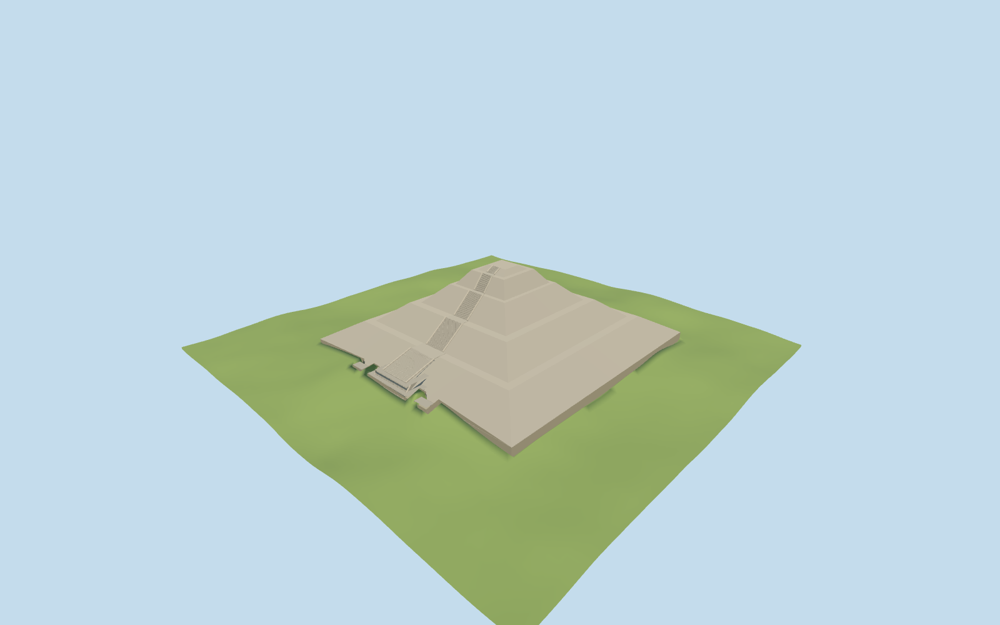

# Pyramid of the Sun

Specific Pyramid of the Sun exterior: five mapped sloping stages, horizontal terraces and flat summit; continuous west stair flights, landings and independently mapped projecting lower U-shaped platforms. No intact summit temple, individual stone inventory, visitors or hidden interiors.

## Evidence and reconstruction

Published dimensions and reconstructed details are separated in spec.json. Primary references:

- [Reference](https://commons.wikimedia.org/wiki/File:Teotihuacan_Sun_Front.jpg)

Two common256² volcanic masonry/grain graphs with metric UVs and linear tints. No embedded image,unique atlas or photo pixels. Two registered recipes reconstruct the master and four explicit browser levels.

## Model and axes

2,216 triangles; 6,648 vertices; 3 material groups; 268,388 bytes. Native bounds: -118.100, -10.000, -111.040 to 118.060, 65.700, 111.071. Source hash: `sha256:19167bdf373b316068d7513ca32c11f063107de9b1e051aa24e8126e758ad001`.

{"x":"east-southeast across pyramid","y":"up","z":"south-southwest"}

Unmodified161-square/6m normal Mapzen-USGS grid retained. Reference at native[-130,0] on the west approach setsY0 at2307.075m; the center sample2348.057m is the existing terrain mound and is deliberately not the model datum. Only the mapped occupied footprint is cut; a complete opaque floor and bounded excavation/foundation joins are present at every level. Coarse edge heights and the reconstructed65m summit are visualization fits,not surveyed elevations.

## Reproduce

Run `node packages/worldgen/scripts/generate-additional-landmarks.mjs --ids=N0493` (or add `--check`). The generator preserves manually edited masters by checking their baseline hashes. Import through the standard authored-model workflow with optimization disabled; then capture all QA cameras, including shared-surface views.

## Pending work

- Specific Pyramid of the Sun exterior: five mapped sloping stages, horizontal terraces and flat summit; continuous west stair flights, landings and independently mapped projecting lower U-shaped platforms. No intact summit temple, individual stone inventory, visitors or hidden interiors.
- Q29238/relation3373254 identifies the pyramid. Standard pinned PMTiles principal building52776561506502 and24 roof/platform parts define the225m main base, west projection, terrace edges and signed15.53-degree axis. The full parent outline including projections is236×222m.
- Retained65m architectural height and mapped part heights16.25/32.5/48.75/61/65m establish the vertical stages. Regularized rectangular terrace bounds retain the mapped center offset. Exact stair counts,width transitions,cheek heights and the small summit inset are picture-guided approximations.
- Unmodified161-square/6m normal Mapzen-USGS grid retained. Reference at native[-130,0] on the west approach setsY0 at2307.075m; the center sample2348.057m is the existing terrain mound and is deliberately not the model datum. Only the mapped occupied footprint is cut; a complete opaque floor and bounded excavation/foundation joins are present at every level. Coarse edge heights and the reconstructed65m summit are visualization fits,not surveyed elevations.
- The standard DEM smooths the original mound and cannot establish surveyed footing/summit elevations. Bounded joins retain coarse edge heights;fine stonework,visitors,landscaping,hidden chambers and historical temple reconstructions are omitted.

This bundle follows the medium-fi standard. Medium-fi appearance and geographic fit are reviewed separately. Hash-bound visual acceptance is recorded separately after capture inspection.

## Additional geographic data

©OpenStreetMap contributors;Protomaps;Mapzen/USGS terrain.
