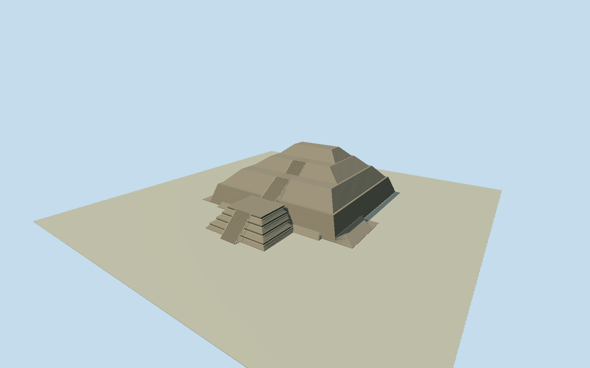

# Pyramid of the Moon

Whole surviving Pyramid of the Moon, its receding worn masonry tiers, summit, central upper stair flights and intrinsic projecting stepped talud-tablero front platform with axial stair. Preserve complete native outline including projections and irregular rear notch. Exclude separate plaza pyramids/altars, Pyramid of the Sun, Palace of Quetzalpapálotl, avenue, mountains, trees, visitors, temporary access barriers and interiors. Warm grey-brown rough volcanic rubble, subdued pale stone ledges and recessed dark tablero panels. Four stepped projecting talud-tablero bodies, real central tread/riser stairs, upper two axial flights/landings, broad battered main tiers and worn open summit. Do not substitute a regular four-sided ideal pyramid, add a summit temple, fill the entire plaza or use the posterized green image for colors.

Authoring state: **review-in-qa.json**. Current completion evidence is in [qa.json](qa.json) and the [completion ledger](../../../../qualla-structures/batches/qualla-002.PROGRESS.md).

- [Pyramid of the Moon](https://qualla.com/pyramid-of-the-moon/)

Native named pyramid way148480246/Q29240, all21 unique perimeter vertices (22 closed positions), including full projecting platform/stair foot and irregular west/rear notch. Front platform ledges from native ways1073687046..7053/7059; axial access from16126294 and1073687054..7058. Fixed whole-envelope midpoint anchor [-98.84396359604472,19.69951782590822], heading -0.27895362671173113 from northern edge before terrain or geometry; local+X ESE/+Z SSW toward plaza. Whole native envelope144.37m by156.68m is consistent with rounded INAH140x150m base, not a survey. Main tier levels/inset rings, platform16m height and stair counts are photographic architectural estimates; no rescaling native geometry to rounded published dimensions.

Whole surviving native21vertex pyramid outline and complete projecting front platform, four talud-tablero bodies, three axial stair flights, upper ledges and worn flat summit. Main tiers/inset rings/platform16m/crown45.2m/56+44+32 detailed treads and hidden rear wear are architectural estimates from five clear originals and native access/ledge controls, not an archaeological measured reconstruction. Distant levels aggregate stair treads.

Five already-published exact own CC0 originals individually inspected/native-SHA1-bound: Syced2007 images5/6/10/11 and Goose friend2015. Goose image is strongly posterized and supplies topology only. Gorgo template-only PD candidate and Syced14/15 of Pyramid of the Sun unused. No source metadata/categories/article body/imagery-policy changes, protected official photos/plans, supplemental imagery, photo textures, generated bitmap or downloaded mesh.

Primary INAH text supplies broad height/base scale and distinguishes separate Structure A12m south; no official image pixels or protected plan adopted. Whole native144.37x156.68m envelope retained rather than rescaling to rounded140x150m public dimensions. No summit temple/ancient colored stucco/interiors/tunnels/excavated earlier phases/other plaza pyramids/altars/avenue/mountains/temporary barriers/visitors.

Independent256m129square2m field/all16641heights/PNG/two original Terrarium tiles frozen before geometry unchanged. Providerplazadatum2314.9264m/absolute2309.0654..2339.2687m/sourcepixel4.497714218753129m do not imply survey accuracy or bare-earth resolution. The composite likely includes monumental relief; default host terrain/actual plaza contacts unverified. No fitting, flattening, source height deletion or reacquisition. Ordinary preview/replacementdisabled; flat review fixtures separate from actual geographic ground.

Build: `node packages/worldgen/scripts/generate-authored-places.mjs --ids=pyramid_of_the_moon`. Add `--check` to verify exact regeneration. 21986 triangles; 4 materials; no embedded photographs.
