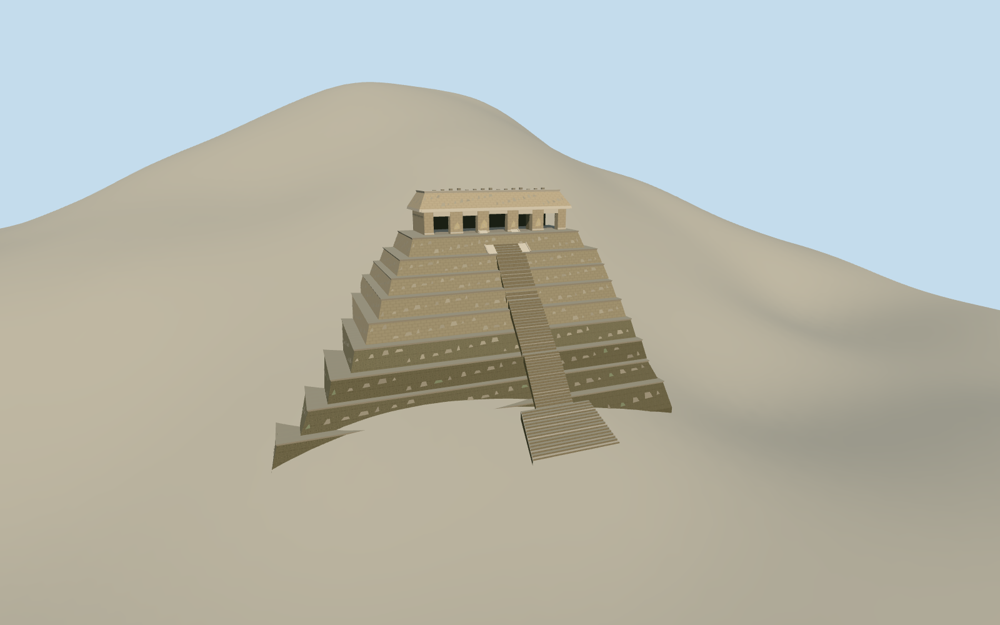

# Temple of the Inscriptions

The surviving stepped Temple of the Inscriptions at Palenque. Limestone terraces, the north stair, five-opening sanctuary, and surviving roof crest stubs.

Authoring state: **review-in-qa.json**. Current completion evidence is in [qa.json](qa.json) and the [completion ledger](../../../../qualla-structures/batches/qualla-003.PROGRESS.md).

- [Temple of the Inscriptions](https://qualla.com/temple-of-the-inscriptions/)

Standing post-restoration exterior. Lower covered masonry, the asymmetric original base against the hill, individual reliefs and the shape of roof comb remnants are approximated. The lost upper comb and the concealed burial chambers are outside the exterior representation.

The OSM interpretation bounds the visible 40 m by 31 m shape. The archaeological 55 m by 35 m base dimensions guide a larger lower envelope. The placement preserves the boundary to Temple XIII and uses an estimated widened eastern toe.

The used independent source terrain is unchanged. The geographic display masks only beneath the modeled stepped envelope and lowest stair, where the coarse elevation source includes both mound and ground.

Build: `node content/worldgen/source/places/9g/9gn/temple_of_the_inscriptions/models/generate-temple-of-the-inscriptions.mjs`. Add `--check` to verify exact regeneration. 3702 triangles; 5 materials; no embedded photographs.
