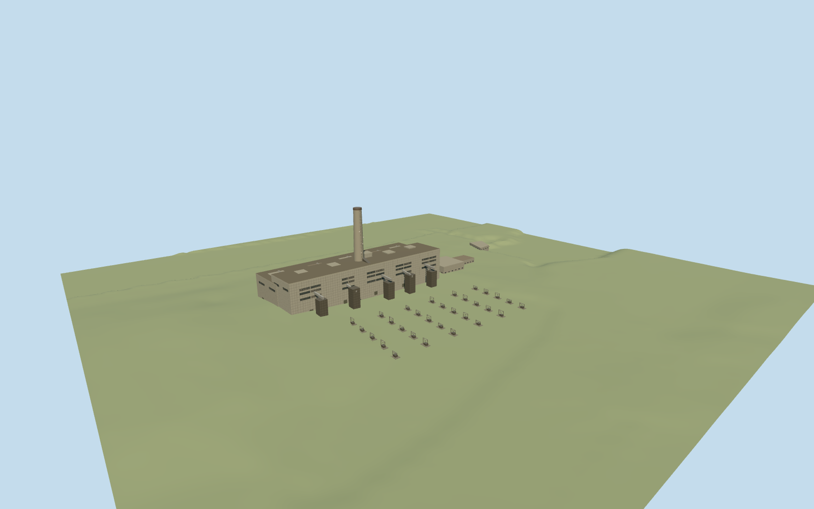

# Encina Power Station

Retired Encina Power Station in March 2019, with connected turbine and boiler halls, a single tapered concrete stack, east switchyard and intake at Agua Hedionda Lagoon.

Authoring state: **review-in-qa.json**. Current completion evidence is in [qa.json](qa.json) and the [completion ledger](../../../../qualla-structures/batches/qualla-003.PROGRESS.md).

- [Encina Power Station](https://qualla.com/encina-power-station/)

The model represents the retired steam plant on March 10, 2019, with a conservative August 2018 through December 2019 viewer interval. The present-day replacement generating plant is outside this model.

The aerial traces are roof observations and have up to several metres of displacement on tall features. The stack’s surveyed plan coordinate, footing diameter, individual unit schedules and exact façade bay widths are approximations.

The project filings disagree between a nominal 400-foot stack height and a 400-foot top elevation above mean sea level. The model uses the site-specific top elevation and the original modern terrain datum. Historical fill, dredging and paved grades may differ.

Switchyard frames and ductwork are representative. The cooling system interiors, live equipment, transmission lines and offshore works are outside the exterior scope.

Build: `node content/worldgen/source/places/9m/9mu/encina_power_station/models/generate-encina-power-station.mjs`. Add `--check` to verify exact regeneration. 8514 triangles; 6 materials; no embedded photographs.
