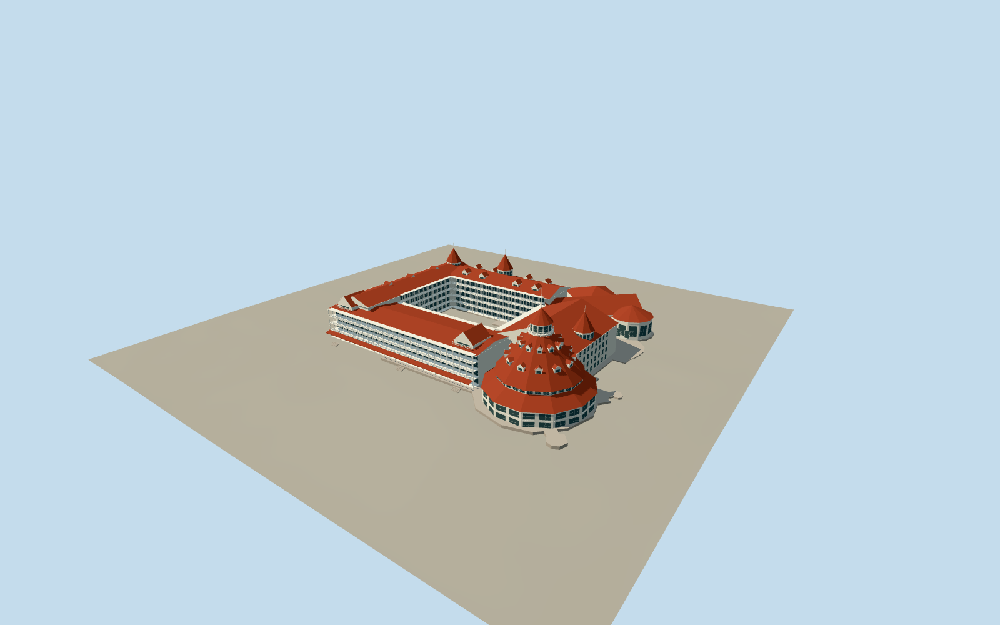

# Hotel del Coronado

Historic white wooden courtyard hotel with stepped red roof wings, ocean-front verandas, dormers, three smaller turrets and the twelve-sided main ballroom roof and belvedere.

Authoring state: **review-in-qa.json**. Current completion evidence is in [qa.json](qa.json) and the [local 100 ledger](../../../../qualla-structures/batches/PROGRESS.md).

- [Hotel del Coronado](https://qualla.com/hotel-del-coronado/)

Mapped historic hotel and open courtyard retained. Current comparison starts with a cleared public-domain Lambert panorama and original government HABS1971drawings4/6/7; earlier CC photos and resort-map artwork are excluded. Historic exterior is modeled at medium-fi; later restoration details are outside the dated evidence.

White painted wood, red shingle roofs, verandas, dormers and twelve-sided ballroom tower are retained. Exact floor heights, roof intersections, hidden facade rhythm, ornament and stair joins are interpretations.

The later connected north service pavilion, separate modern resort neighborhoods, pool complex, utility buildings, landscaping and interiors are excluded.

This dated-reference exterior does not claim every 2021–2025 porch/courtyard restoration detail. Flagpoles are modeled without animated flags.

Independent ground is preserved. Other host terrain sources may differ. Reference images are not embedded or redistributed.

HABS1971sheet7 reconstructs the historical ballroom from original drawings, early photographs and field measurements. Relative lower floor, balcony, eave, belvedere floor, roof and flagpole levels now follow its labels. The existing interpreted ballroom floor+3.9m and native horizontal envelope remain unchanged; no current floor-to-ground or section-width survey claim.

Lower ballroom glazed storey replaces the former tall solid gray foundation. Original survey controls put roof tip38.9774m and flagpole tip47.0038m in this retained model frame. Belvedere wall height, apron/dormer positions, exact current window divisions and restored finishes remain interpretations.

The northern kitchen now has a separate wall volume, hipped roof and interpreted service glazing at all detail levels. Its exposed corners retain the native vector boundary. Fixed-scale HABS plan registration gives 2.54m control RMS and 6.49/7.18m approximate ballroom/kitchen check differences; no survey accuracy is claimed. The closer levels retain the native foundation perimeter. The conservative skyline allowance remains 10.5m; no global mesh-distance certificate is claimed.

Build: `node packages/worldgen/scripts/generate-authored-places.mjs --ids=hotel_del_coronado`. Add `--check` to verify exact regeneration. 58658 triangles; 5 materials; no embedded photographs.
