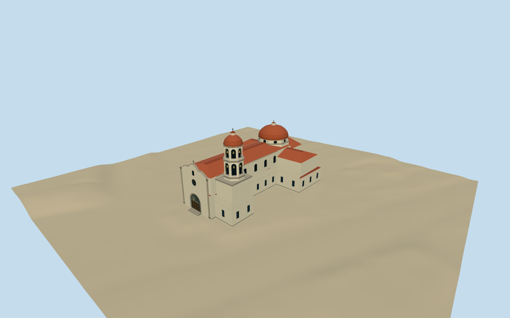

# Mission Basilica San Juan Capistrano

The standing 1986 Mission Basilica, identified by its white Mission Revival frontage, stacked octagonal bell stages and terracotta central cupola.

Authoring state: **review-in-qa.json**. Current completion evidence is in [qa.json](qa.json) and the [completion ledger](../../../../qualla-structures/batches/qualla-003.PROGRESS.md).

- [Mission Basilica San Juan Capistrano](https://qualla.com/mission-basilica-san-juan-capistrano/)

The 18-point exterior perimeter, bell tower and principal cupola dominate the reconstruction. Internal room boundaries, roof junctions, masonry ornament and smaller rear roof heights are approximate.

Scope covers the 1986 basilica and adjoining rooms in its mapped footprint. The original ruined Great Stone Church and historic mission buildings are separate sites.

USGS bare-earth data supplies near-site grades. Entry stairs and wall contact are interpreted from the original photographs and elevation field.

Build: `node content/worldgen/source/places/9m/9mu/mission_basilica_san_juan_capistrano/models/generate-mission-basilica-san-juan-capistrano.mjs`. Add `--check` to verify exact regeneration. 5272 triangles; 6 materials; no embedded photographs.
