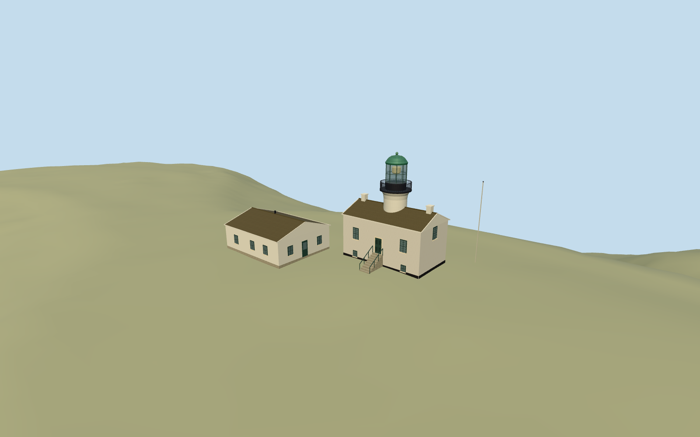

# Old Point Loma Lighthouse

The whitewashed Old Point Loma Lighthouse with dark gabled roofs, circular gallery and oxidized copper lantern, and its assistant keeper’s cottage.

Authoring state: **review-in-qa.json**. Current completion evidence is in [qa.json](qa.json) and the [completion ledger](../../../../qualla-structures/batches/qualla-003.PROGRESS.md).

- [Old Point Loma Lighthouse](https://qualla.com/old-point-loma-lighthouse/)

The named present footprint is used for current wall extents. The register’s earlier 20 by 30 foot description refers to the original residence. HABS records the measured form that is visible today.

The keeper’s cottage is the present reconstruction. Its eaves, sash pattern and roof details are estimated within the separate native footprint.

The preserved lantern is represented as unlit. Lens and tower access details are simplified. Landscaping and temporary signage are outside the built scope.

Build: `node content/worldgen/source/places/9m/9mu/old_point_loma_lighthouse/models/generate-old-point-loma-lighthouse.mjs`. Add `--check` to verify exact regeneration. 4974 triangles; 8 materials; no embedded photographs.
