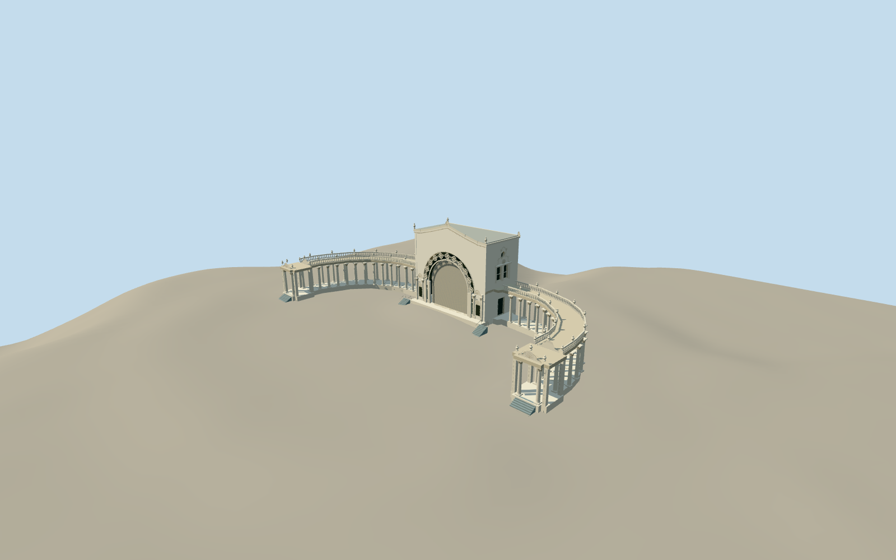

# Spreckels Organ Pavilion

Closed-shutter Spreckels Organ Pavilion: native central rectangular organ house and U-shaped paired-row Corinthian colonnades/terminal portals. Giant round arch with true pierced original floral rosettes/petal tracery and raised moldings, inset ribbed shutter, decorated lower pilasters/plain inset plaques/door+transom bays and shell pediments. Curved triangular central parapet/shell cornice/urns, twin side window recesses/round louver/curved crest and lower barred side entry. Open colonnade bays/coffered ceiling/turned-baluster parapets/urn piers; free terminal columns/flanking relief piers/segmental portal crest/urns and north stairs. Stage apron/paired side stair flights retain independent ground, no plaza seating/fountain/neighbors/interior/organ pipes/flags/art text.

Authoring state: **review-in-qa.json**. Current completion evidence is in [qa.json](qa.json) and the [local 100 ledger](../../../../qualla-structures/batches/PROGRESS.md).

- [Spreckels Organ Pavilion](https://qualla.com/spreckels-organ-pavilion/)

Closed-shutter mode confirmed by verified creator-CC02024 oblique; cleared Qualla2024/2026 wide views and creator-CC02012 arch detail control the main exterior comparison. Temporary performance setup/organ interior, seating/fountain and surface patina are excluded.

Native combined U65vertexoutline and own rectangular23mheightpart retained.13baywingcolumn rhythm/roof heights/steps/fine ornament/rear openings are proportional estimates, not a measured elevation.

Native main23.109×11.805m/overall83.14mwidth controls placement. Former City schematic imagery is excluded; its nominal stage/plaza comparisons are not current authoring or approval evidence.

Original geometric floral/shell/Corinthian relief approximates photographed rhythm; no fine plaque text/figurative sculpture, organ-pipe interior, seats/plaza/fountain/landscape/flags/streetlights/neighbors.

Independent terrain acquired before geometry; no flattening/model-fitted heights.

13baywing rhythm with12free columns per row is photo-counted approximation; actual irregular native outline controls floor/roof strip. Native23mcentralpart/top used nominally; facade profile/cornice/column7.05m/roof7.65m/balustrade8.75m/steps and relief are not surveyed.

Chosen closed shutter omits performance interior/organ pipes; inset plain plaques omit actual text. Fine Corinthian/shell/flower forms are original abstractions. Closed-shutter/side appearance follows the verified creator-CC0 oblique; hidden rear facade and roof service details remain conservative interpretations of native mapped massing, not photographic replicas. Earlier CC/aerial/plan/report imagery is excluded.

Build: `node packages/worldgen/scripts/generate-authored-places.mjs --ids=spreckels_organ_pavilion`. Add `--check` to verify exact regeneration. 57983 triangles; 7 materials; no embedded photographs.
