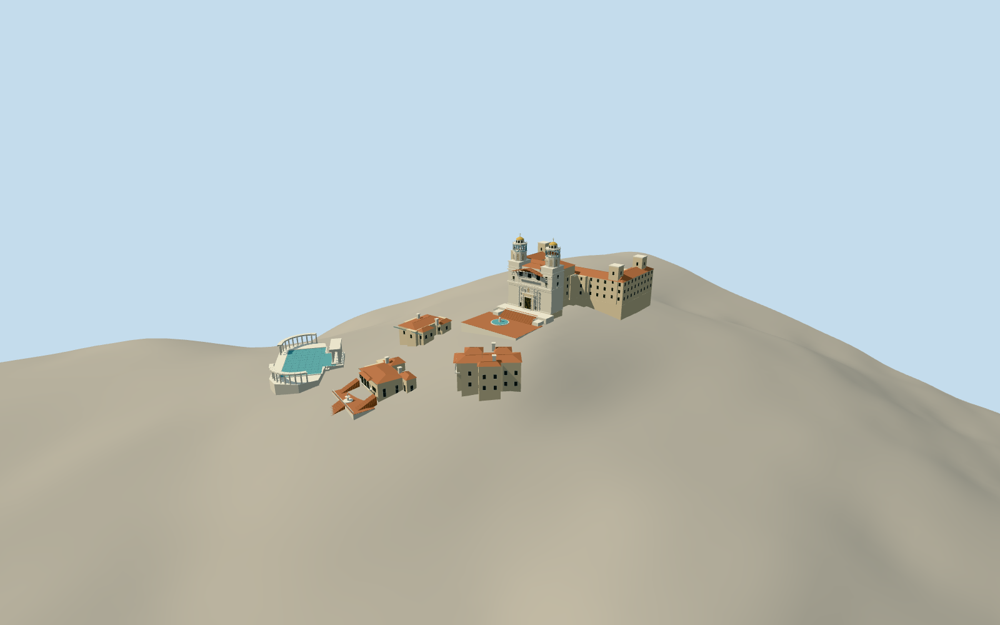

# Hearst Castle

Casa Grande with twin tiled bell towers and timber balcony, its stepped rear wings, three distinct guest houses, Neptune pool temple and curved colonnades, Roman Pool exterior with rooftop tennis courts, and immediate entrance terraces.

Authoring state: **review-in-qa.json**. Current completion evidence is in [qa.json](qa.json) and the [local 100 ledger](../../../../qualla-structures/batches/PROGRESS.md).

- [Hearst Castle](https://qualla.com/hearst-castle/)

Qualla public-domain corpus searched first. New portal construction follows the inspected original Daderot CC0 Casa Grande facade photograph; prior attribution-licensed imagery is excluded as a current control. Map/site layout and source ground retained; not an architectural or land survey.

The rectangular stone entrance has actual jamb/head reveals, threshold steps, recessed metal grille with arched fan and opaque inner boundary. Width, 0.55 m depth, levels and ornament are photographic estimates; interiors are not modeled.

Main facade and twin towers, rear wing layout, three guest-house footprints, pool temple/colonnades and terraced setting are retained. Fine carved figures, tile motifs, unseen window rhythms, interiors and complete garden ornament are generalized or omitted.

The 1941 aerial is supplementary layout evidence only. Modern exterior photographs control visible fabric; exact current roof services and restoration details remain uncertain.

Neptune pool center is mapped; basin dimensions come from California State Parks. Detailed curved perimeter, retaining joins and vertical terrace levels are interpretations, with unmodified host terrain retained for review.

Guest roofs and hidden sides are conservative approximations. Outlying service buildings, the broader estate, vegetation and zoo are outside this model. Reference photos are not embedded or redistributed.

Build: `node packages/worldgen/scripts/generate-authored-places.mjs --ids=hearst_castle`. Add `--check` to verify exact regeneration. 25427 triangles; 4 materials; no embedded photographs.
